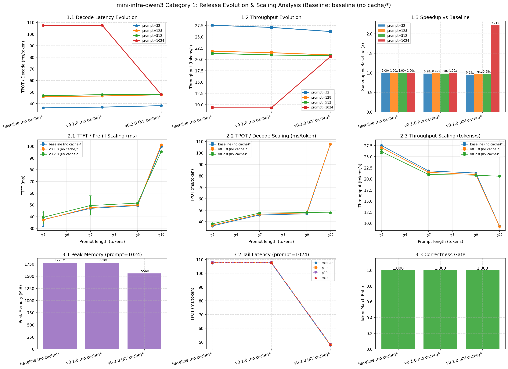
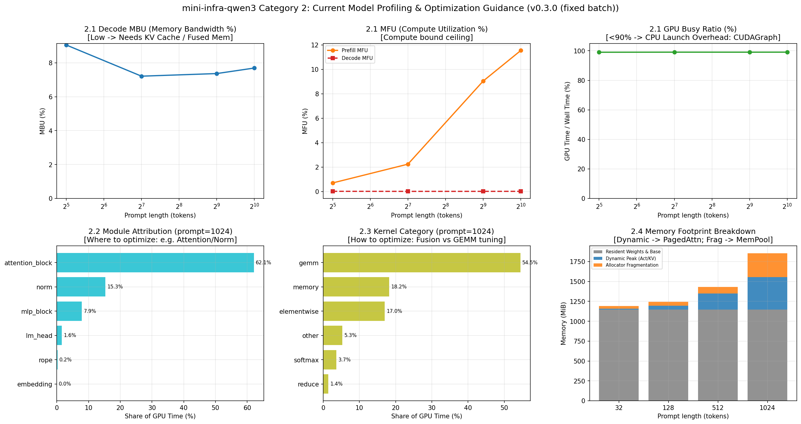

# mini-infra-qwen3

本项目采用 **特性驱动（Feature-Driven）** 的工程演进路线，以最精简、清晰的 Python 和 PyTorch 原生实现，从零解析现代大模型推理引擎的核心机制与优化演进。

---

## 特性全景 (Features)

### 已实现特性
- **手写 Qwen3-0.6B 模型架构**：基于纯原生 PyTorch 实现完整前向计算，不依赖 Transformers 模型代码，不引入黑盒优化，清晰展示每一层计算逻辑。
- **轻量原生 Tokenizer**：纯 Python + regex 实现的 Byte-level BPE Tokenizer，直接解析权重目录下的 `tokenizer.json`，内建 non-thinking Chat Template，不依赖 tokenizers / Transformers。
- **KV Cache 显存与计算优化**：实现原生显式 `KVCache` 容器，Prefill 阶段建立缓存，自回归 Decode 每步只计算增量 Token，消除历史重复前向计算；支持精确显存占用统计与逐步延迟分位数（P50/P95）分析。
- **单请求与固定批处理（Fixed Batching）自回归推理**：支持 greedy decoding 逐 Token 生成与左填充（Left Padding）对齐，支持 `--compare-feature` 对比特性标志（如 `kv-cache`）或批处理策略（如 `fixed-batching`）并自动计算加速比。
- **严格精度对照**：内建与 Hugging Face 参考实现的逐 Token 对齐程序，以及手写模型开启/关闭 KV Cache 的逐步 Logits 对齐工具。
- **轻量 CPU 快速自检**：使用随机生成的小尺寸配置模型，无需下载真实模型权重即可在数秒内验证因果掩码与网络计算。

### 规划中特性 (Roadmap)
- [ ] **FlashAttention / SDPA 算子融合**：优化 Attention 显存与计算访存瓶颈
- [ ] **FlashAttention-Varlen**：针对可变长度输入的 FlashAttention  
- [ ] **Continuous Batching 调度**：支持多请求动态并发与动态组批
- [ ] **PagedAttention 内存管理**：非连续显存分页分配与碎片消除
- [ ] **Tensor Parallelism (TP)**：张量并行分布式推理

---

## 目录结构

```text
mini-infra-qwen3/
├── src/
│   └── mini_infra/
│       ├── __init__.py                # 统一导出核心 API：generate, GenerationResult, Mode, load_model 等
│       ├── model/                     # 统一模型与 Tokenizer 域
│       │   ├── config.py              # Qwen3Config 模型配置
│       │   ├── qwen3.py               # RMSNorm, RotaryEmbedding, Attention, MLP, Qwen3ForCausalLM
│       │   ├── tokenizer.py           # Qwen3Tokenizer
│       │   └── cache.py               # KVCache 键值缓存容器与显存统计
│       ├── generation/                # 核心文本生成引擎域
│       │   ├── engine.py              # generate 统一生成入口与调度流程
│       │   ├── mode.py                # Mode、FeatureFlag 与 BatchingMethod 模式定义
│       │   ├── state.py               # 批自回归循环状态机 BatchGenerationState
│       │   ├── types.py               # 推理结果容器 GenerationResult 与强类型数据结构
│       │   └── preprocessing.py       # Prompt 规约与左填充（Left Padding）
│       ├── profiling/                 # 算子耗时剖析域
│       │   ├── tracer.py              # PyTorch Profiler 打点、Scope 注入与 ProfileCollector
│       │   ├── analyzer.py            # 耗时统计、Kernel 分类与跨 run 聚合
│       │   └── types.py               # OpLatencyBreakdown, KernelInfo, TensorBoardOptions
│       ├── cli/
│       │   └── run_inference.py       # mini-infra-run：单请求/批处理推理、计时与特性对比
│       ├── verification/              # 正确性验证与数值等价性工具包
│       │   ├── smoke.py               # mini-infra-smoke：随机小模型快速自检（CPU）
│       │   └── parity/                # 精度与等价性对齐工具包
│       │       ├── compare_cache.py   # mini-infra-compare-cache：KV Cache 前后逐步 Logits 对齐
│       │       ├── compare_batch.py   # mini-infra-compare-batch：固定批处理请求隔离与数值对齐
│       │       └── compare_transformers.py # mini-infra-compare：与 Transformers 对齐
│       └── bench/
│           ├── types.py               # 评测强类型领域模型 CaseBenchmarkResult 与分布统计
│           ├── workloads.py           # 合成 Prompt 与变长预算序列生成工具
│           ├── suites.py              # Benchmark Suite 配置注册表（Protocol 规范）
│           ├── common.py              # 共享基准基础设施、指标计算与目录常量
│           ├── run_case.py            # mini-infra-bench-case：单 case 基准测试执行引擎
│           ├── run_suite.py           # mini-infra-bench-suite：预设测试套件执行引擎
│           ├── check_regression.py    # mini-infra-bench-regression：轻量质量守门（仅 0/1 退出码）
│           └── plotting/              # 绘图工具包
│               ├── history.py         # mini-infra-bench-plot-history：读取 result-history/ 生成演进趋势图
│               └── compare.py         # mini-infra-bench-plot-compare：对比独立 JSON 结果绘制多维对比图
├── tests/
│   ├── unit/                          # CPU 单元测试（pytest）
│   └── gpu/
│       └── parity/                    # GPU 精度与等价性对齐测试（pytest tests/gpu/parity/）
├── benchmarks/
│   ├── data/                          # golden_output_tokens.json、reference.json（需提交）
│   ├── suites/                        # 预设基准测试套件配置（YAML）
│   ├── result-history/                # 每个版本一份 <commit>_<tag>.json
│   └── reports/                       # SUMMARY.md、evolution_and_scaling.png、profiling_and_optimization.png（生成物）
├── docs/
│   └── profiling.md                   # 算子耗时剖析、Trace 导出与可视化分析指南
├── .github/workflows/
│   ├── cpu-ci.yml                     # CPU 上 ruff + pytest
│   ├── pr-perf-regression.yml         # PR 提测：GPU runner 上的性能回归守门
│   └── release-benchmark.yml          # Tag 发布：GPU runner 上的全量基准与趋势图
├── .pre-commit-config.yaml            # ruff（commit）+ 性能回归（pre-push）
├── pyproject.toml                     # 依赖、入口点、ruff/pytest 配置的唯一来源
├── requirements.txt                   # 基础推理最小依赖
├── requirements-compare.txt           # 对齐评测扩展依赖
├── requirements-lock.txt              # 完整依赖锁文件
├── CONTRIBUTING.md                    # 贡献指南与日常开发工作流（CPU/GPU 测试、质量守门）
├── RELEASE.md                         # 特性发布与 Minor Release 标准流程 (SOP)
├── LICENSE                            # 开源许可证
└── README.md                          # 项目文档与使用指南
```

---

## 验证环境

- **实例规格**：GCP `g2-standard-4`
- **GPU**：NVIDIA L4 24GB
- **CPU**：4 vCPU (Intel Xeon @ 2.20GHz)
- **内存**：16 GiB
- **操作系统**：Ubuntu 22.04 LTS
- **Python**：3.10
- **GPU 驱动**：580.178.04
- **CUDA Runtime**：12.6
- **PyTorch**：2.7.1+cu126
- **Transformers**：4.51.3
- **模型 revision**：`c1899de289a04d12100db370d81485cdf75e47ca` (`Qwen/Qwen3-0.6B`)

---

## 快速上手

### 环境准备与安装

从项目根目录执行：

```bash
python3 -m venv .venv
source .venv/bin/activate
python -m pip install --upgrade pip

# 安装完整锁版本依赖（推荐，用于精确复现）
python -m pip install -r requirements-lock.txt

# 或者只安装基础运行依赖
python -m pip install -r requirements.txt
```

安装项目（命令行入口依赖它）：
```bash
pip install -e .                    # 仅推理
pip install -e ".[compare,bench]"   # 加上 Transformers 对照与绘图
pip install -e ".[dev]"            # 开发：pytest、ruff、pre-commit
```

> **提示**：首次运行会从 Hugging Face 下载固定版本的 `Qwen/Qwen3-0.6B`。如果服务器访问 Hugging Face 受限，可设置镜像端点：
> ```bash
> export HF_ENDPOINT=https://hf-mirror.com
> ```

---

### 快速自检

使用随机生成的小模型在 CPU 上快速验证模型结构与 Causal Mask 计算正确性（无需下载真实权重）：

```bash
mini-infra-smoke
```

输出 `smoke test passed` 即表示自检通过。完整的 CPU 测试集（含 smoke test）可用 `pytest -m "not gpu"` 运行。

---

### 运行推理与计时

```bash
# 1. 比较指定特性的 enable 与 disable 对照（如 KV Cache 开启/关闭）
mini-infra-run \
  --compare-feature kv-cache \
  --prompts "请用一句话介绍 KV Cache。" \
  --max-new-tokens 32

# 2. 单模式或固定批处理（Fixed Batching）运行多条提示词
mini-infra-run \
  --batching-method fixed-batching \
  --prompts "用一句话解释 Prefill。" "用一句话解释 Decode。" \
  --max-new-tokens 32

# 3. 对比两种批处理策略（如串行 none 与固定批处理 fixed-batching）
mini-infra-run \
  --compare-feature none fixed-batching \
  --prompts "用一句话解释 Prefill。" "用一句话解释 Decode。" \
  --max-new-tokens 32
```

输出包含生成 Token IDs、生成文本、Prefill 延迟、平均 Decode 延迟、P50/P95 步延迟、Prefill 后已分配显存、峰值显存与最终 KV Cache 数据量；在 `--compare-feature` 模式下自动给出两组生成的逐 Token 一致性校验及加速比分析。

---

## 性能评估与基准演进 (Benchmarks)

本项目采用严格的数据驱动与时间线演进追踪，每个特性的引入均经过全矩阵基准测试与性能诊断。

完整的多版本评测数据表、加速比对比与 Profiling 诊断详见 [SUMMARY.md](./benchmarks/reports/SUMMARY.md)。

### 1. 跨版本演化与扩展趋势 (Evolution & Scaling Across Releases)


### 2. 当前版本深度剖析与优化指引 (Profiling & Next Steps)


---

## 工程规范与工作流指引 (Workflows & Guides)

为了保持项目首页高信噪比，各阶段详细的工程实践与操作指南已整理归档至专属文档：

* 🛠️ **[贡献与日常开发指南 (CONTRIBUTING.md)](CONTRIBUTING.md)**
  * 本地开发环境配置与 Pre-commit 守护安装
  * 代码规范检查（Ruff）与 CPU 快速冒烟自检（`mini-infra-smoke`、pytest）
  * GPU 端到端精度对齐（固定批处理请求隔离、KV Cache 前后数值对齐、Transformers 对照）
  * 零性能倒退守护（Zero-Regression Guard：`mini-infra-bench-regression`）与独立全量基准对比测量
* 🔍 **[算子性能剖析与 Trace 指南 (docs/profiling.md)](docs/profiling.md)**
  * 使用 `mini-infra-bench-case` 采样生成详细性能诊断数据
  * 导出 Chrome / TensorBoard Trace（`*.pt.trace.json`）
  * 使用 **Perfetto Web UI** 秒级加载与 60fps 交互缩放查看 CUDA Stream 与 Kernel 耗时
  * 远程实例 TensorBoard 启动与 IDE / SSH 端口转发
  * 硬件带宽利用率（MBU）与显存碎片诊断思路
* 🚀 **[特性发布流程 SOP (RELEASE.md)](RELEASE.md)**
  * 核心特性发版 5 步走（质量自检 → 版本号升级 → 全量基准固化 → 代码提交 → Git Tag 打标）
  * 数据流约定与特性（Release Feature）命名规范
  * GitHub Actions 自动云端测试与评测产物归档机制

---

## 致谢与参考 (Acknowledgments)

- [SVDX-lab/miniinfra](https://github.com/SVDX-lab/miniinfra/)

