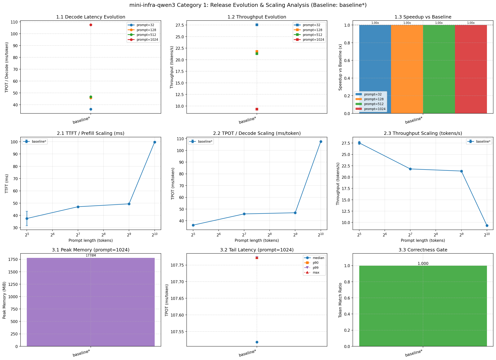
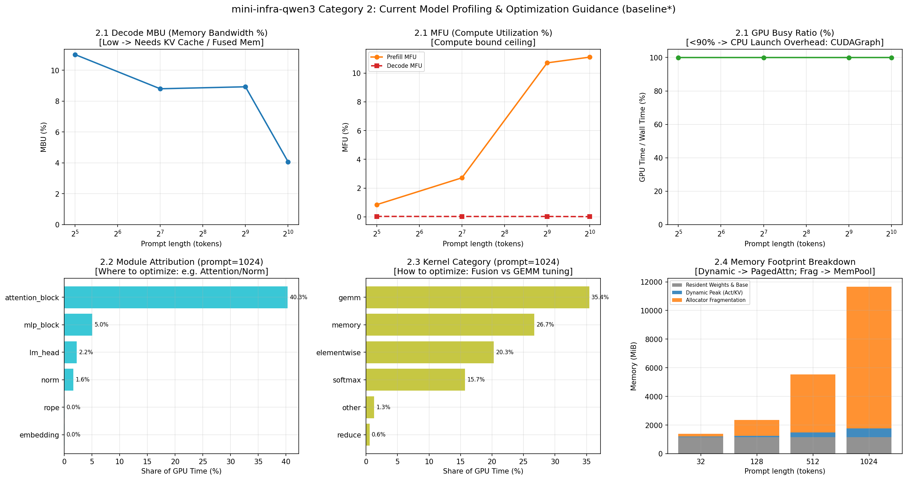

# Benchmark 性能评估与演进分析报告

基准版本：`baseline*` (`a497386`)，GPU：NVIDIA L4，数值为 median，括号内为相对基准的加速比（>1 表示更快）。

| 版本 | commit | batch | prompt | output | TTFT (ms) | TPOT (ms) | 吞吐 (tok/s) | 显存 (MiB) | 正确性 |
| :--- | :--- | :-: | :-: | :-: | :-: | :-: | :-: | :-: | :-: |
| baseline* | a497386 | 1 | 32 | 64 | 37.49 (1.00x) | 36.29 (1.00x) | 27.5 (1.00x) | 1201 | ✅ |
| baseline* | a497386 | 1 | 128 | 64 | 47.04 (1.00x) | 45.86 (1.00x) | 21.8 (1.00x) | 1257 | ✅ |
| baseline* | a497386 | 1 | 512 | 64 | 49.38 (1.00x) | 46.84 (1.00x) | 21.3 (1.00x) | 1480 | ✅ |
| baseline* | a497386 | 1 | 1024 | 64 | 99.68 (1.00x) | 107.52 (1.00x) | 9.3 (1.00x) | 1778 | ✅ |

## 一、跨版本演化与扩展趋势 (Evolution & Scaling Across Releases)

## 二、当前版本深度剖析与优化指引 (Profiling & Next Steps)

基于当前版本 `baseline*` 在长上下文（`prompt=1024`）下的基准测量与 profiling 结果，诊断如下：

### 1. 架构模块瓶颈诊断（改哪里？）
- 🔴 **Attention 模块耗时占比最高（40.3%）**：
  - **现状**：自回归 Decode 阶段重复计算全量上下文历史，计算与访存开销随序列长度急剧膨胀。
  - 👉 **优先优化行动**：**引入 KV Cache** 将每步全量重算解耦，预期可带来 5x~10x 以上吞吐跃升；后续进一步接入 **FlashAttention / SDPA 算子融合**。

### 2. 算子类型与访存诊断（怎么改？）
- 🔹 **GEMM 矩阵乘占 35.4%**，**Elementwise + Memory 搬运占 47.0%**。
  - 访存搬运和小算子占用了近三分之一的 GPU 时间，说明存在较多碎片化临时张量读写。
  - 👉 **技术路线**：结合 Triton 或 PyTorch Inductor 进行横向与纵向算子融合，减少 SRAM 与 HBM 之间的中间写回。

### 3. 硬件物理天花板差距
- 🔹 **Decode MBU（显存带宽利用率）仅为 4.1%**：
  - 当前 Decode 受限于重复计算而非饱和访存，距离理想的 Memory-bound 饱和线（60%~80%）仍有巨大空间。
- 🔹 **GPU 忙碌比例达到 100.0%**：当前几乎无 CPU 空泡，瓶颈纯在 GPU 端计算与访存。

### 4. 显存足迹与碎片诊断
- 🔹 在长序列下，纯动态增量（激活与状态）为 **632.8 MiB**，PyTorch Allocator 碎片与预留达到 **9890.1 MiB**。
  - 👉 **优化行动**：进入长文本及多 Batching 场景后，应引入 **PagedAttention（分页显存管理）** 避免非连续预分配带来的显存碎片。

### 5. 当前 Top 8 热点 Kernel 明细
| 序号 | Kernel 名称 | 类别 | CUDA 耗时 (ms) | 耗时占比 | 调用次数 |
| :-: | :--- | :-: | :-: | :-: | :-: |
| 1 | `aten::copy_` | memory | 1816.65 | 13.0% | 23616 |
| 2 | `aten::mm` | gemm | 1463.55 | 10.5% | 12608 |
| 3 | `ampere_bf16_s1688gemm_bf16_128x128_ldg8_f2f_s` | gemm | 1162.08 | 8.3% | 12767 |
| 4 | `aten::_softmax` | softmax | 1100.24 | 7.9% | 1792 |
| 5 | `void (anonymous namespace)::softmax_warp_forw` | softmax | 1083.76 | 7.7% | 1764 |
| 6 | `void at::native::vectorized_elementwise_kerne` | memory | 874.44 | 6.2% | 9149 |
| 7 | `aten::bmm` | gemm | 857.04 | 6.1% | 3584 |
| 8 | `void at::native::unrolled_elementwise_kernel<` | memory | 845.74 | 6.0% | 9085 |

