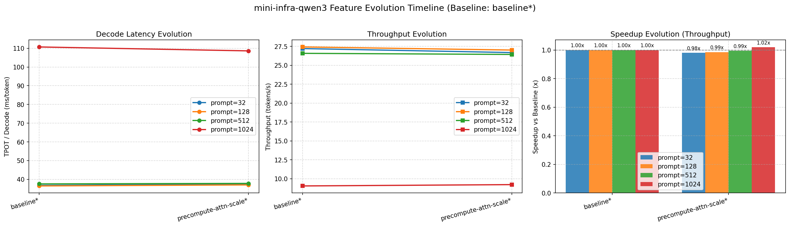
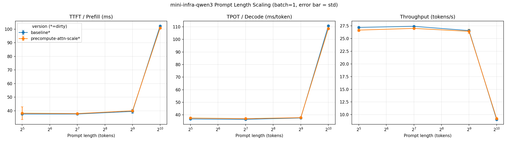

# Benchmark 汇总

基准版本：`baseline*` (`5d5bd0a`)，GPU：NVIDIA L4，数值为 median，括号内为相对基准的加速比（>1 表示更快）。

| 版本 | commit | batch | prompt | output | TTFT (ms) | TPOT (ms) | 吞吐 (tok/s) | 显存 (MiB) | 正确性 |
| :--- | :--- | :-: | :-: | :-: | :-: | :-: | :-: | :-: | :-: |
| baseline* | 5d5bd0a | 1 | 32 | 64 | 37.59 (1.00x) | 36.74 (1.00x) | 27.2 (1.00x) | 1201 | ✅ |
| baseline* | 5d5bd0a | 1 | 128 | 64 | 37.60 (1.00x) | 36.45 (1.00x) | 27.4 (1.00x) | 1257 | ✅ |
| baseline* | 5d5bd0a | 1 | 512 | 64 | 39.52 (1.00x) | 37.54 (1.00x) | 26.6 (1.00x) | 1480 | ✅ |
| baseline* | 5d5bd0a | 1 | 1024 | 64 | 102.22 (1.00x) | 110.72 (1.00x) | 9.0 (1.00x) | 1778 | ✅ |
| precompute-attn-scale* | 33dcce3 | 1 | 32 | 64 | 38.18 (0.98x) | 37.47 (0.98x) | 26.7 (0.98x) | 1201 | ✅ |
| precompute-attn-scale* | 33dcce3 | 1 | 128 | 64 | 37.93 (0.99x) | 37.01 (0.98x) | 27.0 (0.99x) | 1257 | ✅ |
| precompute-attn-scale* | 33dcce3 | 1 | 512 | 64 | 39.98 (0.99x) | 37.80 (0.99x) | 26.4 (0.99x) | 1480 | ✅ |
| precompute-attn-scale* | 33dcce3 | 1 | 1024 | 64 | 100.86 (1.01x) | 108.62 (1.02x) | 9.2 (1.02x) | 1778 | ✅ |

## 可视化趋势分析

### 1. 特性演进时间线 (Feature Evolution Timeline)

### 2. 序列长度扩展曲线 (Prompt Length Scaling)

