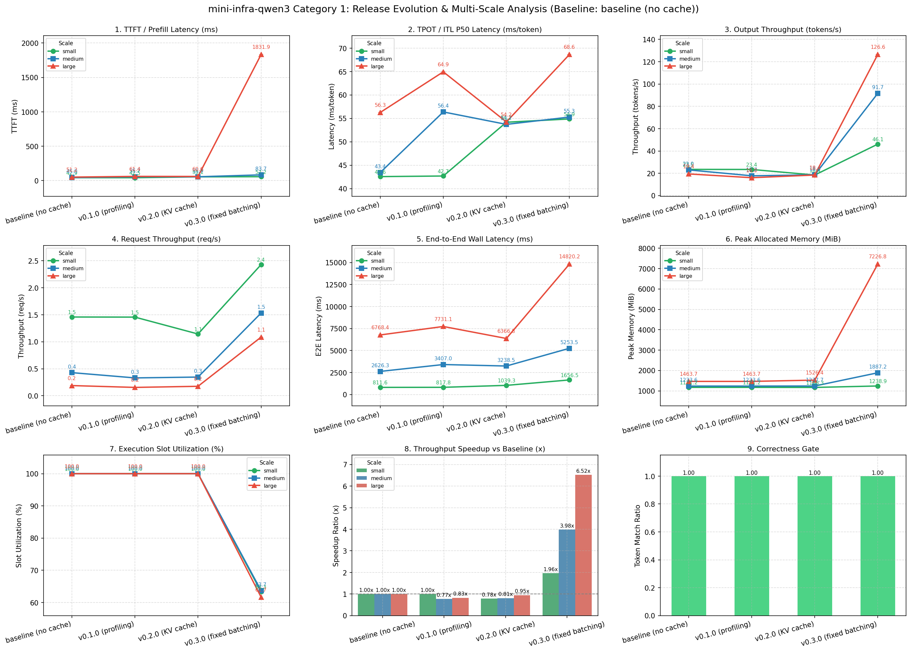
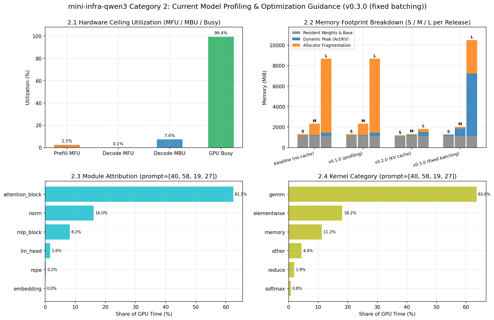

# Lockstep 齐步推理基准演进与性能剖析报告

基准版本：`baseline (no cache)` (`a497386`)，GPU：NVIDIA L4，数值为 median，括号内为相对同 Scale 基准的变化比（>1 表示更快/更高）。

| 版本 | Scale | commit | batch | prompt | max_new_tokens | TTFT (ms) | TPOT (ms) | 吞吐 (tok/s) | 显存 (MiB) | 槽位利用率 | 正确性 |
| :--- | :-: | :--- | :-: | :-: | :-: | :-: | :-: | :-: | :-: | :-: | :-: |
| baseline (no cache) | `small` | a497386 | 4 | 40/58/19/27 | 15/30/10/21 | 42.88 (1.00x) | 42.56 (1.00x) | 23.5 (1.00x) | 1171 | 100.0% | ✅ |
| baseline (no cache) | `medium` | a497386 | 8 | 75..231(μ=142) | 35..94(μ=60) | 45.02 (1.00x) | 43.43 (1.00x) | 23.0 (1.00x) | 1234 | 100.0% | ✅ |
| baseline (no cache) | `large` | a497386 | 16 | 269..947(μ=549) | 68..189(μ=117) | 51.21 (1.00x) | 56.26 (1.00x) | 19.4 (1.00x) | 1464 | 100.0% | ✅ |
| v0.1.0 (profiling) | `small` | 915b0d9 | 4 | 40/58/19/27 | 15/30/10/21 | 42.49 (1.01x) | 42.69 (1.00x) | 23.4 (1.00x) | 1171 | 100.0% | ✅ |
| v0.1.0 (profiling) | `medium` | 915b0d9 | 8 | 75..231(μ=142) | 35..94(μ=60) | 55.70 (0.81x) | 56.37 (0.77x) | 17.7 (0.77x) | 1234 | 100.0% | ✅ |
| v0.1.0 (profiling) | `large` | 915b0d9 | 16 | 269..947(μ=549) | 68..189(μ=117) | 61.41 (0.83x) | 64.94 (0.87x) | 16.0 (0.83x) | 1464 | 100.0% | ✅ |
| v0.2.0 (KV cache) | `small` | 437d41d | 4 | 40/58/19/27 | 15/30/10/21 | 55.05 (0.78x) | 54.17 (0.79x) | 18.4 (0.78x) | 1168 | 100.0% | ✅ |
| v0.2.0 (KV cache) | `medium` | 437d41d | 8 | 75..231(μ=142) | 35..94(μ=60) | 55.87 (0.81x) | 53.71 (0.81x) | 18.6 (0.81x) | 1238 | 100.0% | ✅ |
| v0.2.0 (KV cache) | `large` | 437d41d | 16 | 269..947(μ=549) | 68..189(μ=117) | 60.58 (0.85x) | 54.24 (1.04x) | 18.4 (0.95x) | 1526 | 100.0% | ✅ |
| v0.3.0 (fixed batching) | `small` | 1c21386 | 4 | 40/58/19/27 | 15/30/10/21 | 57.25 (0.75x) | 54.87 (0.78x) | 46.1 (1.96x) | 1239 | 63.3% | ✅ |
| v0.3.0 (fixed batching) | `medium` | 1c21386 | 8 | 75..231(μ=142) | 35..94(μ=60) | 83.74 (0.54x) | 55.28 (0.79x) | 91.7 (3.98x) | 1887 | 63.7% | ✅ |
| v0.3.0 (fixed batching) | `large` | 1c21386 | 16 | 269..947(μ=549) | 68..189(μ=117) | 1831.90 (0.03x) | 68.65 (0.82x) | 126.6 (6.52x) | 7227 | 61.7% | ✅ |

## 一、跨版本演化与扩展趋势 (Evolution & Scaling Across Releases)

## 二、当前版本深度剖析与优化指引 (Profiling & Next Steps)

基于当前版本 `v0.3.0 (fixed batching)`（`prompt=[40, 58, 19, 27]`）下的基准测量与 profiling 结果，诊断如下：

### 1. 架构模块瓶颈诊断（改哪里？）
- 🔴 **Attention 模块耗时占比最高（62.5%）**：
  - 👉 **优先优化行动**：引入 KV Cache / FlashAttention 算子融合。
- 🟡 **RMSNorm 调用开销显著（耗时占比 16.0%）**：建议实施 Fused RMSNorm。

### 2. 算子类型与访存诊断（怎么改？）
- 🔹 **GEMM 矩阵乘占 63.6%**，**Elementwise + Memory 搬运占 29.3%**。

### 3. 硬件物理天花板差距
- 🔹 **Decode MBU（显存带宽利用率）为 7.4%**。
- 🔹 **GPU 忙碌比例达到 99.4%**：瓶颈主要在 GPU 端计算与访存。

### 4. 显存足迹与碎片诊断
- 🔹 纯动态增量为 **93.8 MiB**，Allocator 碎片与预留为 **47.1 MiB**。

### 5. 当前 Top 8 热点 Kernel 明细
| 序号 | Kernel 名称 | 类别 | CUDA 耗时 (ms) | 耗时占比 | 调用次数 |
| :-: | :--- | :-: | :-: | :-: | :-: |
| 1 | `aten::mm` | gemm | 166.59 | 30.7% | 5910 |
| 2 | `void cutlass::Kernel2<cutlass_80_wmma_te` | gemm | 159.62 | 29.4% | 5713 |
| 3 | `aten::mul` | elementwise | 24.42 | 4.5% | 11850 |
| 4 | `aten::copy_` | memory | 23.89 | 4.4% | 10472 |
| 5 | `void at::native::elementwise_kernel<128,` | elementwise | 16.30 | 3.0% | 6750 |
| 6 | `aten::cat` | other | 12.57 | 2.3% | 3393 |
| 7 | `aten::add` | elementwise | 10.56 | 1.9% | 7619 |
| 8 | `void at::native::unrolled_elementwise_ke` | memory | 10.39 | 1.9% | 4260 |

