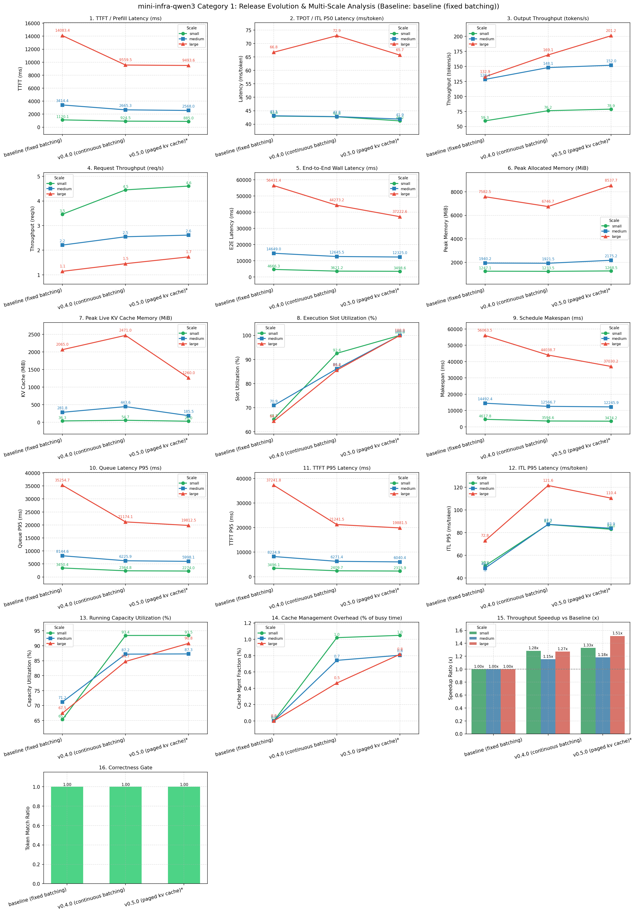
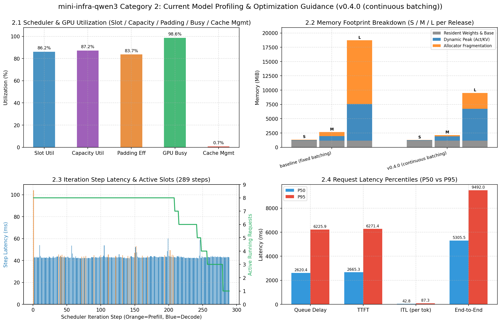

# Scheduler 队列调度基准演进与性能剖析报告

基准版本：`baseline (fixed batching)` (`f03abf6`)，GPU：NVIDIA L4，数值为 median，括号内为相对同 Scale 基准的变化比（>1 表示更快/更高）。

| 版本 | Scale | commit | total_requests | prompt | max_new_tokens | Makespan (ms) | TTFT P50 (ms) | ITL P95 (ms) | 吞吐 (tok/s) | 峰值显存 (MiB) | 活跃 KV (MiB) | KV 块池 (MiB) | batch slot 利用率 | 正确性 |
| :--- | :-: | :--- | :-: | :-: | :-: | :-: | :-: | :-: | :-: | :-: | :-: | :-: | :-: | :-: |
| baseline (fixed batching) | `small` | f03abf6 | 16 | 16..63(μ=35) | 9..31(μ=17) | 4617.81 (1.00x) | 1120.13 (1.00x) | 50.76 | 59.3 (1.00x) | 1247 | 36.3 | — | 65.2% | ✅ |
| baseline (fixed batching) | `medium` | f03abf6 | 32 | 64..247(μ=138) | 33..93(μ=58) | 14492.43 (1.00x) | 3414.45 (1.00x) | 48.64 | 128.4 (1.00x) | 1940 | 281.8 | — | 70.9% | ✅ |
| baseline (fixed batching) | `large` | f03abf6 | 64 | 261..1003(μ=554) | 65..189(μ=116) | 56063.47 (1.00x) | 14083.35 (1.00x) | 72.84 | 132.9 (1.00x) | 7582 | 2065.0 | — | 64.4% | ✅ |
| v0.4.0 (continuous batching) | `small` | f03abf6 | 16 | 16..63(μ=35) | 9..31(μ=17) | 3594.63 (1.28x) | 924.53 (1.21x) | 87.19 | 76.2 (1.28x) | 1234 | 54.7 | — | 92.6% | ✅ |
| v0.4.0 (continuous batching) | `medium` | f03abf6 | 32 | 64..247(μ=138) | 33..93(μ=58) | 12566.73 (1.15x) | 2665.31 (1.28x) | 87.34 | 148.1 (1.15x) | 1921 | 443.6 | — | 86.2% | ✅ |
| v0.4.0 (continuous batching) | `large` | f03abf6 | 64 | 261..1003(μ=554) | 65..189(μ=116) | 44038.66 (1.27x) | 9559.55 (1.47x) | 121.57 | 169.1 (1.27x) | 6747 | 2471.0 | — | 85.6% | ✅ |
| v0.5.0 (paged kv cache)* | `small` | 5343b51 | 16 | 16..63(μ=35) | 9..31(μ=17) | 3474.18 (1.33x) | 885.00 (1.27x) | 82.99 | 78.9 (1.33x) | 1269 | 28.0 | 35.0 | 100.0% | ✅ |
| v0.5.0 (paged kv cache)* | `medium` | 5343b51 | 32 | 64..247(μ=138) | 33..93(μ=58) | 12245.92 (1.18x) | 2568.00 (1.33x) | 83.89 | 152.0 (1.18x) | 2175 | 185.5 | 253.8 | 100.0% | ✅ |
| v0.5.0 (paged kv cache)* | `large` | 5343b51 | 64 | 261..1003(μ=554) | 65..189(μ=116) | 37030.23 (1.51x) | 9493.63 (1.48x) | 110.43 | 201.2 (1.51x) | 8538 | 1260.0 | 1744.8 | 100.0% | ✅ |

## 一、跨版本演化与扩展趋势 (Evolution & Scaling Across Releases)

## 二、当前版本深度剖析与优化指引 (Profiling & Next Steps)

基于当前调度器版本 `v0.5.0 (paged kv cache)*`（`requests=32, max_running=8`）下的基准测量与轨迹剖析，诊断如下：

### 1. batch slot 与并发容量利用率诊断（调度效率）
- 🔹 **执行 batch slot 有效率（Slot Utilization）为 100.0%**，**并发容量利用率（Running Capacity Utilization）为 87.3%**，**Prompt Padding 有效率为 83.7%**。

### 2. 请求排队与尾延迟诊断（P50 vs P95）
- 🔹 **排队延迟**：P50 = `2525.0 ms`，P95 = `5998.1 ms`；**TTFT**：P50 = `2568.0 ms`，P95 = `6040.4 ms`。
- 🔹 **Decode 步间延迟（ITL）**：P50 = `41.89 ms`，P95 = `83.89 ms`，Max = `100.29 ms`。
- 🟡 **观测到新请求 Prefill 插队导致的 Decode 尾延迟毛刺（ITL Max > 1.4x P50）**：建议下一步演进引入 **Token Budget 调度器与 Chunked Prefill**，将长 Prompt 拆分为小块与 Decode 交织执行。

### 3. 显存足迹与 KV Cache 管理诊断
- 🔹 **峰值活跃 KV Cache 为 185.5 MiB**，动态显存峰值增量为 **1030.2 MiB**，Allocator 预留碎片为 **274.8 MiB**，Cache 搬移开销占比为 **0.81%**。
- 👉 **下一步核心演进方向**：引入 **Prefix Cache（前缀缓存与物理块复用）** 与 **Chunked Prefill / 融合 Paged Attention Kernel**，按物理 Block 按需复用长 Prompt 并消除 Prefill 阶段的高峰值激活与跨层 gather 拷贝开销。

