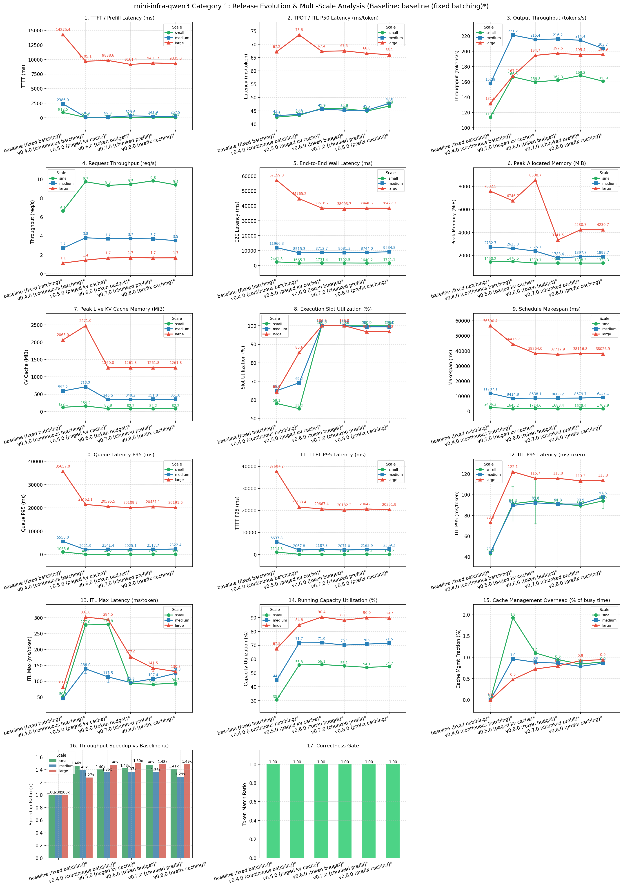
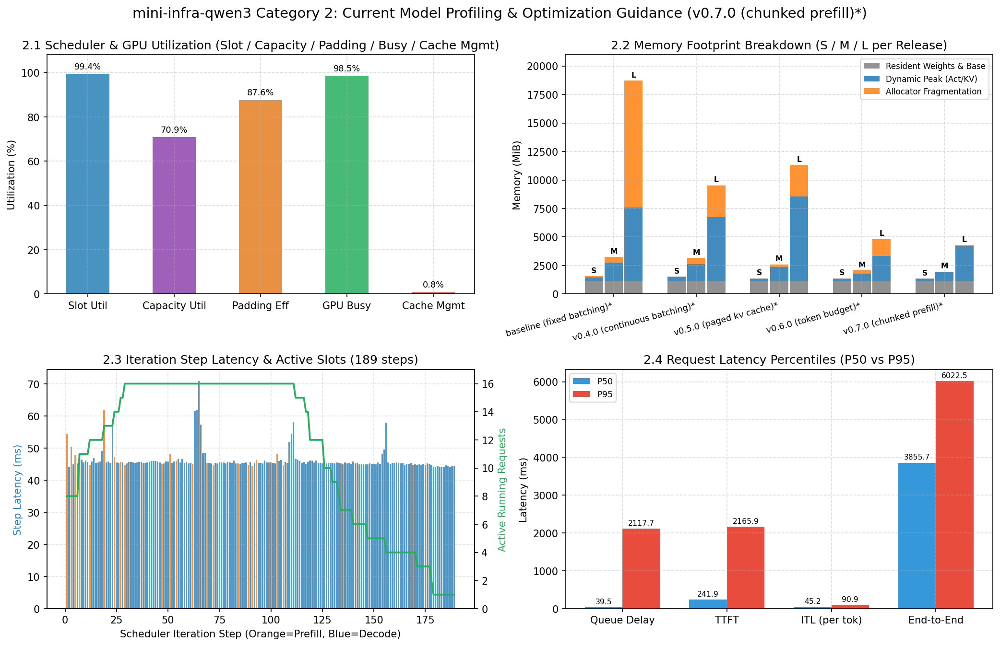

# Scheduler 队列调度基准演进与性能剖析报告

基准版本：`baseline (fixed batching)*` (`e347f65`)，GPU：NVIDIA L4，数值为 median，括号内为相对同 Scale 基准的变化比（>1 表示更快/更高）。

| 版本 | Scale | commit | total_requests | prompt | max_new_tokens | Makespan (ms) | TTFT P50 (ms) | ITL P95 (ms) | 吞吐 (tok/s) | 峰值显存 (MiB) | 活跃 KV (MiB) | KV physical block pool (MiB) | batch slot 利用率 | 正确性 |
| :--- | :-: | :--- | :-: | :-: | :-: | :-: | :-: | :-: | :-: | :-: | :-: | :-: | :-: | :-: |
| baseline (fixed batching)* | `small` | e347f65 | 16 | 16..63(μ=35) | 9..31(μ=17) | 2406.19 (1.00x) | 912.46 (1.00x) | 43.25 | 113.9 (1.00x) | 1450 | 122.1 | 122.1 | 58.1% | ✅ |
| baseline (fixed batching)* | `medium` | e347f65 | 32 | 64..247(μ=138) | 33..93(μ=58) | 11787.12 (1.00x) | 2386.05 (1.00x) | 44.18 | 157.9 (1.00x) | 2733 | 593.2 | 593.2 | 65.0% | ✅ |
| baseline (fixed batching)* | `large` | e347f65 | 64 | 261..1003(μ=554) | 65..189(μ=116) | 56590.35 (1.00x) | 14275.42 (1.00x) | 73.30 | 131.6 (1.00x) | 7582 | 2065.0 | 2065.0 | 64.4% | ✅ |
| v0.4.0 (continuous batching)* | `small` | e347f65 | 16 | 16..63(μ=35) | 9..31(μ=17) | 1645.23 (1.46x) | 57.43 (15.89x) | 91.26 | 166.5 (1.46x) | 1477 | 159.2 | 159.2 | 55.2% | ✅ |
| v0.4.0 (continuous batching)* | `medium` | e347f65 | 32 | 64..247(μ=138) | 33..93(μ=58) | 8414.75 (1.40x) | 105.36 (22.65x) | 89.64 | 221.2 (1.40x) | 2623 | 712.2 | 712.2 | 69.2% | ✅ |
| v0.4.0 (continuous batching)* | `large` | e347f65 | 64 | 261..1003(μ=554) | 65..189(μ=116) | 44415.66 (1.27x) | 9705.08 (1.47x) | 122.06 | 167.7 (1.27x) | 6747 | 2471.0 | 2471.0 | 85.6% | ✅ |
| v0.5.0 (paged kv cache)* | `small` | e347f65 | 16 | 16..63(μ=35) | 9..31(μ=17) | 1714.55 (1.40x) | 55.75 (16.37x) | 93.83 | 159.8 (1.40x) | 1339 | 85.8 | 105.0 | 100.0% | ✅ |
| v0.5.0 (paged kv cache)* | `medium` | e347f65 | 32 | 64..247(μ=138) | 33..93(μ=58) | 8638.10 (1.36x) | 99.74 (23.92x) | 92.14 | 215.4 (1.36x) | 2375 | 346.5 | 449.8 | 100.0% | ✅ |
| v0.5.0 (paged kv cache)* | `large` | e347f65 | 64 | 261..1003(μ=554) | 65..189(μ=116) | 38263.96 (1.48x) | 9838.55 (1.45x) | 115.74 | 194.7 (1.48x) | 8539 | 1260.0 | 1744.8 | 100.0% | ✅ |
| v0.6.0 (token budget)* | `small` | e347f65 | 16 | 16..63(μ=35) | 9..31(μ=17) | 1688.37 (1.43x) | 92.66 (9.85x) | 91.61 | 162.3 (1.43x) | 1339 | 82.2 | 105.0 | 100.0% | ✅ |
| v0.6.0 (token budget)* | `medium` | e347f65 | 32 | 64..247(μ=138) | 33..93(μ=58) | 8608.18 (1.37x) | 329.56 (7.24x) | 90.88 | 216.2 (1.37x) | 1788 | 348.2 | 449.8 | 100.0% | ✅ |
| v0.6.0 (token budget)* | `large` | e347f65 | 64 | 261..1003(μ=554) | 65..189(μ=116) | 37717.91 (1.50x) | 9161.41 (1.56x) | 115.76 | 197.5 (1.50x) | 3342 | 1261.8 | 1744.8 | 100.0% | ✅ |

## 一、跨版本演化与扩展趋势 (Evolution & Scaling Across Releases)

## 二、当前版本深度剖析与优化指引 (Profiling & Next Steps)

基于当前调度器版本 `v0.6.0 (token budget)*`（`requests=32, max_running=16`）下的基准测量与轨迹剖析，诊断如下：

### 1. batch slot 与并发容量利用率诊断（调度效率）
- 🔹 **执行 batch slot 有效率（Slot Utilization）为 100.0%**，**并发容量利用率（Running Capacity Utilization）为 70.1%**，**Prompt Padding 有效率为 92.0%**。

### 2. 请求排队与尾延迟诊断（P50 vs P95）
- 🔹 **排队延迟**：P50 = `281.5 ms`，P95 = `2025.1 ms`；**TTFT**：P50 = `329.6 ms`，P95 = `2071.0 ms`。
- 🔹 **Decode 步间延迟（ITL）**：P50 = `45.21 ms`，P95 = `90.88 ms`，Max = `95.91 ms`。
- 🔹 **迭代调度步数**：Prefill `22` 步 / Decode `168` 步，最长连续 Prefill `1` 步，oversize prefill `0` 次。
- 🟡 **观测到新请求 Prefill 插队导致的 Decode 尾延迟毛刺（ITL Max > 1.4x P50）**：建议引入 **Chunked Prefill**，将长 Prompt 拆分为小块与 Decode 交织执行（软预算下 oversize prefill 仍会整段阻塞）。

### 3. 显存足迹与 KV Cache 管理诊断
- 🔹 **峰值活跃 KV Cache 为 348.2 MiB**，动态显存峰值增量为 **643.4 MiB**，Allocator 预留碎片为 **287.6 MiB**，Cache 搬移开销占比为 **0.86%**。
- 👉 **下一步核心演进方向**：引入 **Prefix Cache（前缀缓存与物理块复用）** 与 **Chunked Prefill / 融合 Paged Attention Kernel**，按物理 Block 按需复用长 Prompt 并消除 Prefill 阶段的高峰值激活与跨层 gather 拷贝开销。

