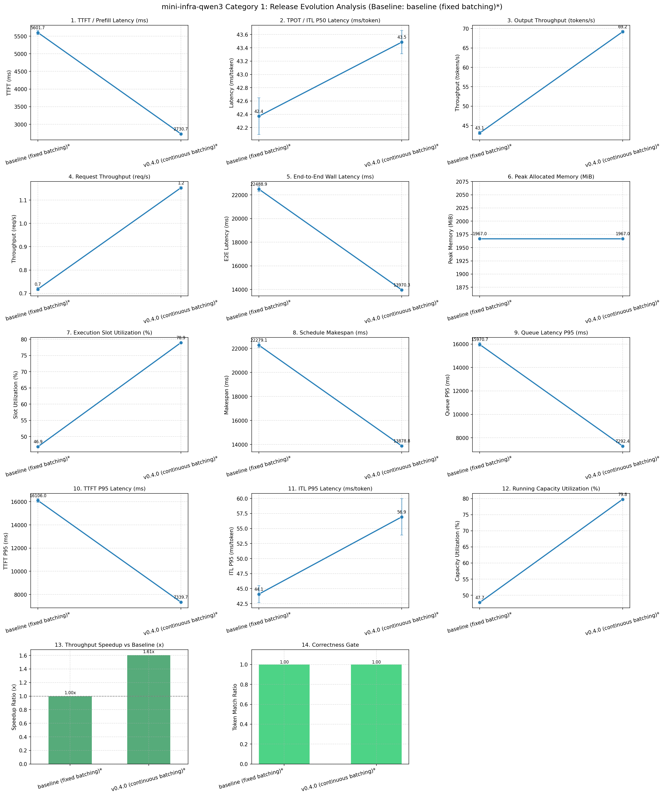
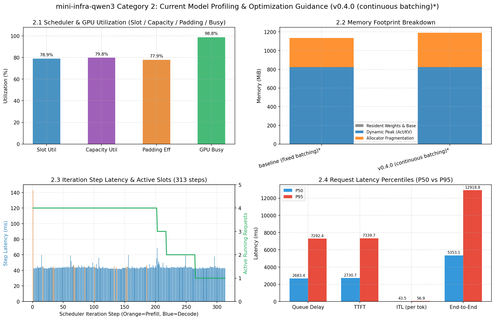

# Scheduler 队列调度基准演进与性能剖析报告

基准版本：`baseline (fixed batching)*` (`a413152`)，GPU：NVIDIA L4，数值为 median，括号内为相对基准的变化比（>1 表示更快/更高）。

| 版本 | commit | batch | prompt | max_new_tokens | Makespan (ms) | TTFT P50 (ms) | ITL P95 (ms) | 吞吐 (tok/s) | 显存 (MiB) | 槽位利用率 | 正确性 |
| :--- | :--- | :-: | :-: | :-: | :-: | :-: | :-: | :-: | :-: | :-: | :-: |
| baseline (fixed batching)* | a413152 | 16 | (64/128/256/512)x4 | (16/64/32/128)x4 | 22279.08 (1.00x) | 5601.69 (1.00x) | 44.09 | 43.1 (1.00x) | 1967 | 46.9% | ✅ |
| v0.4.0 (continuous batching)* | a413152 | 16 | (64/128/256/512)x4 | (16/64/32/128)x4 | 13878.81 (1.61x) | 2730.67 (2.05x) | 56.94 | 69.2 (1.61x) | 1967 | 78.9% | ✅ |

## 一、跨版本演化与扩展趋势 (Evolution & Scaling Across Releases)

## 二、当前版本深度剖析与优化指引 (Profiling & Next Steps)

基于当前调度器版本 `v0.4.0 (continuous batching)*`（`requests=16, max_running=4`）下的基准测量与轨迹剖析，诊断如下：

### 1. 槽位与并发容量利用率诊断（调度效率）
- 🔹 **执行槽位有效率（Slot Utilization）为 78.9%**，**并发容量利用率（Running Capacity Utilization）为 79.8%**，**Prompt Padding 有效率为 77.9%**。

### 2. 请求排队与尾延迟诊断（P50 vs P95）
- 🔹 **排队延迟**：P50 = `2683.4 ms`，P95 = `7292.4 ms`；**TTFT**：P50 = `2730.7 ms`，P95 = `7339.7 ms`。
- 🔹 **Decode 步间延迟（ITL）**：P50 = `43.49 ms`，P95 = `56.94 ms`，Max = `98.81 ms`。
- 🟡 **观测到新请求 Prefill 插队导致的 Decode 尾延迟毛刺（ITL Max > 1.4x P50）**：建议下一步演进引入 **Token Budget 调度器与 Chunked Prefill**，将长 Prompt 拆分为小块与 Decode 交织执行。

### 3. 显存足迹与 KV Cache 管理诊断
- 🔹 **峰值活跃 KV Cache 为 355.2 MiB**，动态显存峰值增量为 **822.0 MiB**，Allocator 预留碎片为 **369.0 MiB**，Cache 搬移开销占比为 **0.57%**。
- 👉 **下一步核心演进方向**：引入 **Paged KV Cache（分页键值缓存）** 与 **Prefix Cache**，按固定大小物理 Block 按需分配与复用，彻底消除按最长序列预分配的显存碎片与稠密槽位搬移。

