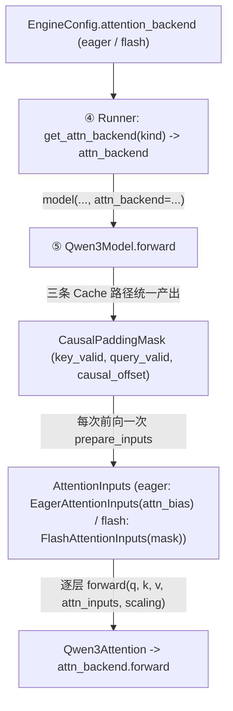

# FlashAttention（attention backend：eager vs flash）

对应《超轻量 AI Infra 教程—推理篇》第 09 章「高性能 Attention」（参考实现：[SVDX-lab/miniinfra chapter_09](https://github.com/SVDX-lab/miniinfra/tree/main/inference/chapter_09)）。本期只改变一个核心变量：**Attention 核心是否物化完整 Score / Probability 矩阵**。Q/K/V 投影、QK Norm、RoPE、权重、Dense / Paged KV Cache、Chunked Prefill、调度策略、输入 Token 与 greedy decoding 全部共用；正式实现不调用 PyTorch SDPA，也不依赖第三方 `flash-attn`。

| backend | 实现 | 中间显存 |
|---|---|---|
| `eager`（baseline） | 显式 `QK^T -> 加性 mask -> float32 softmax -> PV`，GQA 先 `repeat_interleave` 展开 K/V | `O(B · H · Q · K)` Score + Probability + 展开 K/V |
| `flash` | Triton 手写前向 Kernel：分块读 K/V、Online Softmax 累加，Score 只活在寄存器 / 共享内存 | `O(B · Q · H · D)`（只有输出） |

## 一、分层与职责（对标 vLLM attention backend）



| 层 | 模块 | 职责 |
|---|---|---|
| ⑤ Model | [`model/attention/backend.py`](../../src/mini_infra/model/attention/backend.py) | `AttentionBackend`（`prepare_inputs` / `forward`）、`AttentionInputs`、`AttentionBackendKind`、`CausalPaddingMask` |
| ⑤ Model | [`model/attention/eager.py`](../../src/mini_infra/model/attention/eager.py) | `EagerAttentionBackend`：与引入抽象前的 `_attend` 逐算子一致（Baseline 可对照性） |
| ⑤ Model | [`model/attention/flash_attention.py`](../../src/mini_infra/model/attention/flash_attention.py) | Triton Kernel `flash_attention_forward` 与 `FlashAttentionBackend`（仅在选择 flash 时延迟导入 Triton） |
| ⑤ Model | [`model/qwen3.py`](../../src/mini_infra/model/qwen3.py) | 三条路径（No-Cache / Dense / Paged）统一产出 `CausalPaddingMask`，核心计算委托 `attn_backend` |
| ④ Worker | [`worker/base_runner.py`](../../src/mini_infra/worker/base_runner.py) | `BaseModelRunner(attention_backend=...)` 解析为 `attn_backend` 实例，每次前向透传 |
| ② Engine | [`engine/config.py`](../../src/mini_infra/engine/config.py) | `EngineConfig.attention_backend`，与 KV Cache / batching / scheduler 维度正交；非默认时 `str(config)` 追加 `+flash-attention` |

模型仍是 Pure Tensor-In, Tensor-Out：backend 是无状态计算策略，模型不感知其选择来源。

## 二、可见性契约

```text
key_valid:     [batch, kv_len]     bool  False = padding / 尾块未写满 / null block
query_valid:   [batch, query_len]  bool  False = padding Query 行（flash 输出置 0）
causal_offset: int                       Query 行 q 只可见 k <= causal_offset + q（由形状推导，零 Host-Device 同步）
```

| 路径 | key_valid | query_valid | causal_offset |
|---|---|---|---|
| Prefill / Dense Decode / Paged chunk（历史 gather 后拼接） | `attention_mask` | `attention_mask[:, past_len:]` | `past_len` |
| Paged Decode | `positions < context_lens` | 全 True `[B, 1]` | `max_history_len - 1` |

Chunked Prefill 必须用**全局**因果偏移：历史长度为 `P` 时，本轮局部 Query `q` 只能读 `k <= P + q`，不能按局部位置用 `k <= q`。

## 三、Kernel 算法

每个 program 负责 `(batch, query head, BLOCK_M 行)`，逐 `BLOCK_N` 读 K/V，float32 维护 `m / l / acc`：

```text
m_new = max(m, rowmax(S_tile))          # S_tile 预乘 log2(e)，用 exp2 代替 exp
alpha = exp2(m - m_new)
P     = exp2(S_tile - m_new)
l     = alpha * l + rowsum(P)
acc   = alpha * acc + P @ V_tile
O     = acc / l
```

相对 chapter_09 参考实现的工程化增强（vLLM FLASH_ATTN 语义）：

- **原生 GQA**：Query head `h` 直接读 KV head `h // num_kv_groups`，不做 `repeat_interleave` 显存展开；
- **任意 stride**：K/V 只要求末维连续，Paged Decode 按 block table gather 出的 `transpose` 视图直接消费，零 `contiguous()`；
- **因果 Tile 跳过**：Query Tile 只遍历 `k <= causal_offset + Tile 末行` 的 Key 分块（Full Prefill 约省一半）；
- **全屏蔽行防 NaN**：整个 Key 分块都被左 padding 屏蔽时以 0 作指数基准，避免 `(-inf) - (-inf)`；
- **输出布局**：直接写 `[B, Q, H, D]`，o_proj 前无 `transpose + contiguous` 拷贝；
- **float32 IEEE 精度**：float32 输入走 `input_precision="ieee"`（禁用 TF32），支撑 `atol <= 1e-4` 的 float32 Parity。

实现边界：CUDA；bfloat16 / float16 / float32；head_dim 为不小于 16 的 2 的幂；forward-only。不含 backward、dropout、任意稠密 Mask、split-KV（Flash-Decoding）与直接按 block table 读 physical block 的 Paged Kernel。

## 四、使用

```bash
# 推理（对应 chapter_09 run_inference.py --attention-backend flash）
mini-infra run --attention-backend flash \
  --caching-method paged-kv-cache --batching-method continuous-batching \
  --batching-policy chunked-prefill --token-budget 64 --max-new-tokens 16

# eager vs flash 端到端对照（其余 EngineConfig 参数不变）
mini-infra run --compare-feature attention-backend eager flash \
  --caching-method paged-kv-cache --batching-method continuous-batching \
  --batching-policy chunked-prefill --token-budget 64 --max-new-tokens 16

# 正确性（对应 compare_attention.py + compare_model.py）
mini-infra verify flash-attention --output tmp/parity_flash_attention.json

# 独立进程长序列微基准（对应 benchmark_attention.py）
python scripts/benchmark/attention_kernel.py --lengths 256 1024 4096 8192 \
  --output tmp/attention_kernel_prefill.local.json
python scripts/benchmark/attention_kernel.py --mode decode --batch-size 8 \
  --lengths 1024 4096 16384 --output tmp/attention_kernel_decode.local.json
```

## 五、实测（NVIDIA L4 24GB，PyTorch 2.14.1+cu130，Triton 3.8.0）

### 正确性（`mini-infra verify flash-attention`，float32）

| 层级 | 用例 | 最大绝对误差 |
|---|---|---:|
| Kernel | Full Prefill 128 / 非整 Tile 257 / Chunked 64→320 / 左 Padding Chunk Batch / 左 Padding Prefill Batch / Decode 1→1025 | ≤ 8.4e-7 |
| 模型 | Lockstep dense-kv-cache + fixed-batching（全部步 Logits） | 3.7e-5，Token 100% 一致 |
| 模型 | Paged chunked-prefill（首 Token Logits） | 4.0e-5，Token 100% 一致 |

bfloat16 下 Kernel 最大误差约 1e-2（输出本身的 bf16 舍入量级）；28 层归约顺序差异会累积，greedy 临界点可能翻转个别 Token，这是预期现象，正确性结论以 float32 为准。

### Full Prefill 微基准（batch=1，16 Q 头 / 8 KV 头，head_dim=128，bfloat16，因果）

| 长度 | eager p50 | flash p50 | 加速比 | eager 增量峰值显存 | flash 增量峰值显存 |
|---:|---:|---:|---:|---:|---:|
| 256 | 0.478 ms | 0.109 ms | 4.41x | 12.1 MiB | 1.0 MiB |
| 1024 | 2.353 ms | 0.131 ms | 17.95x | 170.0 MiB | 4.0 MiB |
| 4096 | 40.199 ms | 1.553 ms | 25.88x | 2624.0 MiB | 16.0 MiB |
| 8192 | 159.458 ms | 7.481 ms | 21.31x | 10432.0 MiB | 32.0 MiB |

### Decode 微基准（batch=8，Q=1）

| K 长度 | eager p50 | flash p50 | 加速比 | eager 增量峰值显存 | flash 增量峰值显存 |
|---:|---:|---:|---:|---:|---:|
| 1024 | 0.680 ms | 0.221 ms | 3.07x | 65.3 MiB | 0.0 MiB |
| 4096 | 2.852 ms | 0.587 ms | 4.86x | 261.1 MiB | 0.0 MiB |
| 16384 | 11.299 ms | 2.326 ms | 4.86x | 1044.2 MiB | 0.0 MiB |

eager 的增量显存包含 GQA 展开的 K/V 副本与加性 `attn_bias`，二者都是真实 baseline 路径的开销。

## 六、结论边界

- 可推广的机制性结论：Online Softmax 不保存完整 Attention 矩阵即可得到相同数学结果；eager 中间显存随 Full Prefill 长度平方增长，flash 只随输出线性增长；Kernel 级加速会被 Projection / MLP / KV Cache 管理 / 调度稀释，端到端收益远小于微基准（Chunked Prefill 把 Query 长度限制在 token budget 内时尤甚）。
- 不可推广的测量性结论：加速比只对本代码、版本、形状与 L4 负责；教学 Kernel 不代表 PyTorch SDPA、官方 flash-attn 或生产推理框架性能；flash 未直接读取 physical block（Paged Decode 仍先 gather），不能代表生产 PagedAttention 性能。
- 后续演进：Paged-native Kernel（按 block table 直接寻址 physical block pool）、split-KV Decode、varlen（chunk 与 Decode 同一次前向混批）。
