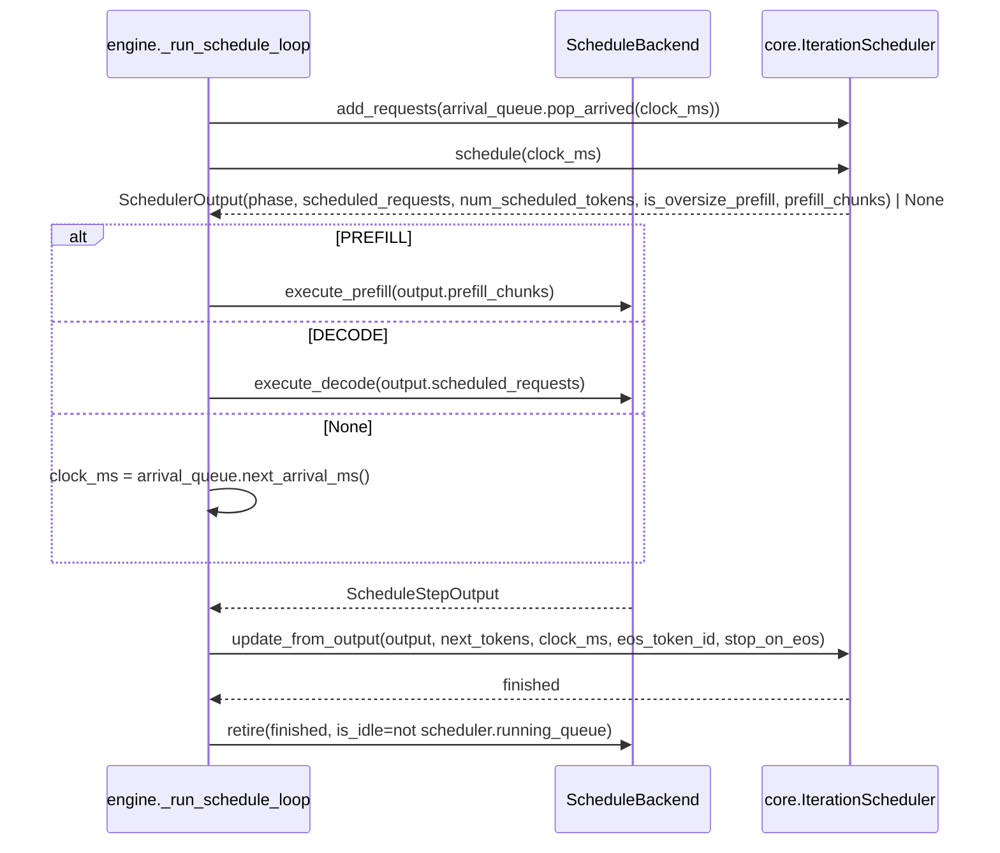

# 迭代级组批与调度策略 (Iteration-level Batching & Scheduling Policy)

> 本文描述 `core.IterationScheduler` 每一步「执行 Prefill 还是 Decode、哪些请求入场」的决策逻辑，以及正交调度维度的演进边界。队列、batch slot 与 KV Cache 的机制见 [Continuous Batching](continuous-batching.md) 与 [Paged KV Cache](paged-kv-cache.md)。

---

## 零、正交调度维度与术语防冲突契约

在现代 LLM 推理引擎（如 vLLM V0/V1、SGLang）中，单步迭代调度包含四个正交决策维度，**严禁将不同维度的策略塞入同一枚举**：

| 决策维度 | 解决的核心问题 | 本项目规范命名 | 业界对照与规划取值 |
|---|---|---|---|
| **1. 请求排队序**<br>*(Queue Ordering)* | `WaitingQueue` 先看谁？`RunningQueue` 满载抢占时先踢谁？ | `queue_policy` (`QueuePolicyKind`)<br>*(TODO)* | 对应 vLLM `--scheduling-policy`：`fcfs`（当前默认）、`priority`（优先级）、`srtf`（最短剩余时间优先） |
| **2. 单步组批与阶段准入**<br>*(Batching / Phase Policy)* | 本轮 Step 如何划定 Prefill / Decode 阶段与单步 Token 预算？ | `batching_policy` (`BatchingPolicyKind`)<br>*(已实现)* | `prefill-first`（默认）、`token-budget`（已实现）、`chunked-prefill`（已实现，P/D 相位互斥；TODO：chunk 与 Decode 同一次前向混批） |
| **3. 抢占/驱逐模式**<br>*(Preemption Mode)* | Decode 步物理块耗尽时，被选中的 Victim 请求如何处置？ | `preemption_mode` (`PreemptionMode`)<br>*(TODO)* | 对应 vLLM `--preemption-mode`：`recompute`（释放块并退回 `WaitingQueue` 重算）、`swap`（换出至 CPU Host Swap Pool） |
| **4. 准入容量水印**<br>*(Admission Watermark)* | Prefill 准入时预留多少空闲块作为安全垫防抢占抖动？ | `watermark`<br>*(TODO)* | 预留空闲 physical blocks 比例（如 `0.05`） |

> [!IMPORTANT]
> **区分 `batching_method` 与 `batching_policy`**：`batching_method`（`none` / `fixed-batching` / `continuous-batching`）决定跨步生命周期机制（是否存在 wave barrier）；`batching_policy`（`prefill-first` / `token-budget` / `chunked-prefill`）决定 `continuous-batching` 下单步如何切分阶段与控制 Prefill 规模。

---

## 一、状态与入场决策收敛于 `IterationScheduler`

对齐 vLLM V1 `Scheduler`，`core.IterationScheduler` 内部直接持有 `WaitingQueue`、`RunningQueue` 与 `KVCacheManager`（Paged 路径），并在 `schedule()` 与 `update_from_output()` 内闭环完成队列状态流转与逻辑块分配/释放。调度主循环（`engine/scheduler_loop.py`）每一步按以下顺序执行：



- **`IterationScheduler(scheduler_config, batching_method, kv_cache_manager)`**（纯 CPU control plane）在 `schedule(clock_ms)` 内一次完成全部入场决策与逻辑资源分配，依次在 `waiting_queue` 的 FCFS 前缀上取交集：
  1. batching 约束：continuous-batching 有 free batch slot 即可入场；fixed-batching / none 须等 `running_queue` 排空（wave barrier）；
  2. batch slot 约束：至多 `running_queue.num_free_batch_slots` 个；
  3. KV 显存约束（仅 Paged，`kv_cache_manager` 非 None）：`KVCacheManager.num_admissible` 在预留 chunked prefill 在途请求尚未写入的 Prompt 块之后可容纳的前缀；
  4. 策略约束：token budget 截断与 decode protection（见下文）。
- 所有约束都是 **FCFS 前缀截断**，可交换、可组合；**不跳过队头**：队头放不下就停，不往后找更短的请求（与 vLLM V1 一致）。
- **状态与逻辑块生命周期闭环**：`schedule(clock_ms)` 原子执行 `waiting_queue.pop_batch`、`running_queue.admit` 及 `kv_cache_manager.allocate_slots`；前向完成后，`update_from_output(...)` 统一推进 `cache_length`（PREFILL 按完成的 chunk 推进至 `chunk.end`，DECODE 递增 1）、为产出 Token 的请求追加 Token（chunked prefill 的中间 chunk 不产出 Token）、对完成请求执行 `kv_cache_manager.free` 与 `running_queue.retire`；`ScheduleBackend` 只消费 `PrefillChunk` / `Sequence[RequestState]` 执行算子与物理缓存读写，对 `RunningQueue` 完全无感知。

## 二、scheduler config

通过 `EngineConfig.scheduler_config`（`SchedulerConfig(max_running_requests=..., batching_policy=...)`）统一承载并发上限 `max_running_requests` 与单步组批策略 `batching_policy`（判别式联合 `BatchingPolicy = PrefillFirstConfig | TokenBudgetConfig | ChunkedPrefillConfig`）：

| `SchedulerConfig` | `batching_policy` | 行为 |
|---|---|---|
| `SchedulerConfig(max_running_requests=N, batching_policy=PrefillFirstConfig())`（默认策略） | `prefill-first` | 入场上限内的 FCFS 前缀整批 Prefill；无可入场请求才 Decode |
| `SchedulerConfig(max_running_requests=N, batching_policy=TokenBudgetConfig(token_budget))` | `token-budget` | 入场上限内再按 token budget 截断 FCFS 前缀，并启用 decode protection |
| `SchedulerConfig(max_running_requests=N, batching_policy=ChunkedPrefillConfig(token_budget))` | `chunked-prefill` | 入场上限内的 FCFS 前缀与在途 chunked prefill 请求共享 token budget，长 Prompt 切成 chunk 跨步推进，并启用 decode protection |

约束（`validate_engine_config` 与 `run_scheduler` 校验）：

- `token-budget` / `chunked-prefill` 仅支持 `continuous-batching`（fixed 的 wave barrier 与 none 串行不存在跨步入场决策）；`chunked-prefill` 另需 `paged-kv-cache`（chunk 的历史 K/V 取自 physical block pool）。
- `token_budget ≥ max_running_requests`（`run_scheduler` 按实际生效的并发上限再校验一次），否则一次完整 Decode 即超预算（对标 vLLM `max_num_batched_tokens ≥ max_num_seqs`）。
- 默认 `prefill-first` 不进入 `str(EngineConfig)`，历史 Record 的 `engine_config` 标识不变；`token-budget` 追加 `+token-budget(token_budget=N)` 后缀，`chunked-prefill` 追加 `+chunked-prefill(token_budget=N)` 后缀。

## 三、token-budget 策略

### 1. 成本模型：padded prompt tokens

本地 Batched Prefill 采用左 Padding，实际送入模型的 Token 数为 `len(batch) × max(prompt_len)`。vLLM 用 varlen 拼接、按真实 Token 计费；此处按 padded prompt tokens 计费才能反映 Compute-Bound Prefill 的真实开销。该值即 `SchedulerOutput.num_scheduled_tokens`（DECODE 时为运行中请求数），经 `ScheduleEvent.num_scheduled_tokens` 透传给 `summarize_schedule` 计算 `padding_efficiency`，是 padded prompt tokens 的单一事实源。

### 2. 软预算与 oversize prefill

无 Chunked Prefill 时长 Prompt 无法拆分。若队头请求单独已超预算，则让它独自 Prefill（oversize prefill），保证 FCFS 队列一定有进展。因此：非 oversize 的 Prefill 满足 `num_scheduled_tokens ≤ token_budget`；oversize Prefill 只含 1 个请求，并以 `SchedulerOutput.is_oversize_prefill` 标记，经 `ScheduleEvent.is_oversize_prefill` 透传。

### 3. decode protection

RunningQueue 非空且上一步是 PREFILL 时，强制执行一步 DECODE。本地无法把 Prefill 与 Decode 放进同一次前向，只能用相位交替近似 vLLM V1「先排 running、再排 waiting」的做法，限制 Prefill burst 对在途请求 ITL 的冲击。

示例（6 个同时到达的 3-token 请求，`max_running_requests=4`，`token_budget=6`）：

| 步 | prefill-first | token-budget |
|---|---|---|
| 1 | PREFILL [0, 1, 2, 3]（12 tokens） | PREFILL [0, 1]（6 tokens） |
| 2 | DECODE | DECODE（decode protection） |
| 3 | DECODE | PREFILL [2, 3]（6 tokens） |

## 四、chunked-prefill 策略

token-budget 的软预算无法切分长 Prompt：队头单独超预算时只能 oversize prefill，整段阻塞在途 Decode。chunked-prefill 把 Prompt 切成 chunk，让 `max_prefill_step_tokens` 恒不超过 `token_budget`（硬预算）。本地实现对标 vLLM V1 的 chunked prefill 语义：请求进入 `RunningQueue` 后以 `cache_length` 记录已写入 KV Cache 的 Prompt 进度（对标 `num_computed_tokens`），部分 Prefill 请求与 Decode 请求同属 `RunningQueue`。

### 1. 状态与数据结构

| 概念 | 代码锚点 | 含义 |
|---|---|---|
| prefill chunk | `PrefillChunk(state, start, end)` | 一次 PREFILL 步为单个请求划定的 Prompt 区间 `[start, end)`；`start` 即 chunk 之前已写入 KV Cache 的 Token 数，同时是 chunk 首 Token 的 `position_ids` |
| chunk 进度 | `RequestState.cache_length` / `RequestState.is_prefilling` | 调度步内按 chunk 推进；`cache_length < prompt_len` 的 RUNNING 请求处于 chunked prefill 中间态 |
| 两类运行请求 | `RunningQueue.prefilling_requests` / `decoding_requests` | DECODE 只含 `decoding_requests`；`SchedulerOutput.scheduled_requests` 在 DECODE 时同样排除半截 Prefill 请求 |
| 步产出 | `SchedulerOutput.prefill_chunks` | PREFILL 步的 chunk 列表（所有策略统一产出：非 chunked 策略恒为整段 Prompt `[0, prompt_len)`）；仅 `PrefillChunk.is_last` 的请求在本步产出首个 Token |

### 2. 成本模型：硬预算

候选集合 = 在途 chunked prefill 请求（入场先后序）+ 受 batching / batch slot / KV 显存约束的 WaitingQueue FCFS 前缀。候选数为 n 时每请求 chunk 上限 `chunk_cap = token_budget // n`，每个请求取 `min(剩余 Prompt, chunk_cap)`（尾 chunk 可更短）。左 Padding 的 padded 成本 `n × max(chunk) ≤ token_budget` 恒成立，故不存在 oversize prefill；`token_budget ≥ max_running_requests` 保证 `chunk_cap ≥ 1`，每个在途请求每步至少推进 1 个 Token。

### 3. decode protection 与 P/D 相位互斥

存在 `decoding_requests` 且上一步是 PREFILL 时强制执行 DECODE（半截 Prefill 请求不算 Decode 请求，只有 Prefill 在途时可连续 PREFILL 直到写满）。本地 Attention 不支持 varlen，chunk 与 Decode 无法同一次前向混批，仍是相位交替；Decode 被 Prefill 阻塞的上界由 `max_prefill_step_ms` 观测，随 `token_budget` 减小而下降（TODO(mixed-batching)：统一 Token-Budget 范式）。

示例（`token_budget=8`，`max_running_requests=4`，同时到达 Prompt 长度 `[10, 10, 3]`）：

| 步 | 相位 | chunk（请求 `[start, end)`） | padded 成本 |
|---|---|---|---|
| 1 | PREFILL | 0 `[0,2)`、1 `[0,2)`、2 `[0,2)`（n=3，上限 2） | 6 |
| 2 | PREFILL | 0 `[2,4)`、1 `[2,4)`、2 `[2,3)` → 请求 2 写满，产出首 Token | 6 |
| 3 | DECODE | 仅请求 2（decode protection） | 1 |
| 4 | PREFILL | 0 `[4,8)`、1 `[4,8)`（n=2，上限 4） | 8 |

### 4. Paged KV Cache：逐 chunk 分配与入场预留

- **逐 chunk 分配**：`schedule()` 对每个 chunk 调用 `KVCacheManager.allocate_slots(request_idx, chunk.num_tokens)` 追加块（累计 Token 数判定是否跨块边界）。
- **入场预留**：`num_admissible(prompt_lens, num_reserved_blocks)` 先扣除在途 chunked prefill 请求尚未写入的 Prompt 块，保证新请求不抢占其后续 chunk 的块，避免两个半截 Prefill 互相等块而卡死。Decode 增长吞掉预留块时 `allocate_slots` 失败，显式 `RuntimeError`（未实现抢占，见 `preemption_mode` TODO）。
- **worker 路径**：`PagedRunner.run_prefill_chunk_step` 把各行 chunk 左 Padding，历史 K/V 经 block table 由 `PagedKVCachePool.gather_blocks` 读回并作为 `DenseAttentionMetadata.past_key_values` 喂模型（模型层无感知，仍是 Tensor-In / Tensor-Out）；`attention_mask` 的历史部分只放行前 `start` 个位置，真实 Token 的 `position_ids` 从 `start` 连续递增，与整段 Prompt 一次 Prefill 严格等价；全部行 `start == 0` 时无历史，与整段 Prompt 走同一前向路径。前向后 `PagedRunner.store_prefill` 按各行 `start_positions` 把 chunk 的 K/V 散写入 physical block pool。

### 5. 与参考实现 chapter_07 的功能对照

| chapter_07 | 本地实现 |
|---|---|
| `SchedulerConfig.mode = full / chunked` | 不引入 `mode`：`full` 即 `token-budget`（软预算、oversize prefill），`chunked` 即 `chunked-prefill`（硬预算） |
| `PrefillPlan(state, start, end)`、`SchedulerOutput.prefill_plans` | `PrefillChunk`、`SchedulerOutput.prefill_chunks` |
| `RequestState.prefill_cursor` / `status = prefilling` | `RequestState.cache_length` / `is_prefilling`（对标 vLLM `num_computed_tokens`，不另设状态枚举） |
| `waiting` / `prefilling` / `running` 三个列表 | `WaitingQueue`；`RunningQueue.prefilling_requests` / `decoding_requests` |
| `PagedKVCache.append_prefill` + `dense_request_cache`（按 chunk 追加、重建单请求 dense 历史） | `store_prefill(start_positions=...)` + `PagedKVCachePool.gather_blocks`（按 block table 批量取历史） |
| 按 `start` 分组、每组一次前向 | 单次前向：历史按最长块数 null block 补齐，`attention_mask` 屏蔽 |
| `prefill_chunk_count` / `max_prefill_tokens_per_iteration` / `max_prefill_iteration_ms` | `num_prefill_chunks` / `max_prefill_step_tokens` / `max_prefill_step_ms` |
| `hard_budget_violations` / `oversize_prefill_iterations` | 硬预算由构造保证（单测与 smoke 断言 `num_scheduled_tokens ≤ token_budget`）/ `num_oversize_prefill_steps`（恒为 0） |
| `padding_fraction` / `budget_utilization` | `1 - padding_efficiency`（既有）；预算利用率可由事件流 `num_scheduled_tokens` 推导 |
| `prefill_started_ms` / `prefill_completed_ms` / `first_token_ms` | `admitted_ms`（入场即开始 Prefill）/ `first_token_ms`（Prompt 写满当步产出首 Token，二者同一时钟点） |

## 五、迭代调度步数与 Prefill 步规模类指标

`summarize_schedule` 由事件流汇总到 `ScheduleMetrics`（Record 中为 `schedule.*`，多轮测量聚合为 `DistributionStats`）：

| 指标 | 含义 |
|---|---|
| `num_prefill_steps` / `num_decode_steps` | PREFILL / DECODE 事件数 |
| `max_consecutive_prefill_steps` | 最长连续 PREFILL 事件数：衡量 Prefill burst 对在途 Decode 的阻塞；token-budget 在 RunningQueue 非空时恒为 1（decode protection） |
| `num_oversize_prefill_steps` | oversize prefill 事件数：预算过小（或长 Prompt 过多）时偏高；chunked-prefill 恒为 0 |
| `num_prefill_chunks` | PREFILL 事件内各请求 Prompt 区间总数（`ScheduleEvent.physical_batch_size` 在 PREFILL 上的和）；非 chunked 策略下等于请求数 |
| `max_prefill_step_tokens` | 单个 PREFILL 步的最大 padded chunk token 数；chunked-prefill 下 ≤ `token_budget` |
| `max_prefill_step_ms` | 单个 PREFILL 步的最长耗时：在途 Decode 被 Prefill 阻塞的上界，直接决定 `itl_ms_max` |

早于 token-budget 的历史 Record 无前四项，早于 chunked-prefill 的历史 Record 无后三项，Schema 中均为 `Optional`（不回填），绘图与报告缺失时跳过。

## 六、不变量与验证

- 各策略只决定「谁在哪一步入场、每步算 Prompt 的哪一段」，`position_ids`、block table 寻址与因果可见范围仍由 worker 保证，逐请求输出与串行 `generate` 逐 Token 一致。
- CPU：`tests/unit/test_scheduler.py`（决策单测，含 chunk 区间、硬预算、decode protection、入场预留）、`test_paged_kv_cache.py`（分轮 chunk 与整段 Prefill 的 K/V 与首 Token 等价）、`test_continuous.py` / `test_paged_scheduler.py`（串行一致性与事件不变量）、`test_compare_schedulers.py`、`mini-infra verify smoke`（`check_token_budget_scheduling` / `check_chunked_prefill_scheduling`）。
- GPU：`mini-infra verify schedulers-token-budget`（`compare_schedulers_token_budget.py` 错峰 Burst 轨迹与指标对比）、`mini-infra verify chunked-prefill`（`compare_chunked_prefill.py` 超长 Prompt 下 `token-budget` vs `chunked-prefill` 逐 Token / 首 Token Logits 误差 / 轨迹对比）与 `tests/gpu/parity/test_scheduler_batch_parity.py` 在 `float32` 下覆盖 Dense / Paged × 预算（含 oversize prefill）及 Paged × chunked-prefill 预算（含每请求每步 1 个 Token 的极限切分）。

## 七、使用

```bash
# 单独启用 token-budget
mini-infra run --batching-method continuous-batching --caching-method paged-kv-cache \
  --batching-policy token-budget --token-budget 256 --max-running-requests 4

# 对比 prefill-first 与 token-budget
mini-infra run --batching-method continuous-batching \
  --compare-feature batching-policy prefill-first token-budget --token-budget 256 \
  --max-running-requests 4

# 启用 chunked-prefill（须 paged-kv-cache + continuous-batching）；对比 token-budget 与 chunked-prefill
mini-infra run --batching-method continuous-batching --caching-method paged-kv-cache \
  --batching-policy chunked-prefill --token-budget 256 --max-running-requests 4
mini-infra run --batching-method continuous-batching --caching-method paged-kv-cache \
  --compare-feature batching-policy token-budget chunked-prefill --token-budget 256 \
  --max-running-requests 4
```

```python
from mini_infra import (
    BatchingMethod,
    ChunkedPrefillConfig,
    EngineConfig,
    PagedCacheConfig,
    SchedulerConfig,
    TokenBudgetConfig,
)

config = EngineConfig(
    PagedCacheConfig(block_size=16),
    batching_method=BatchingMethod.CONTINUOUS,
    scheduler_config=SchedulerConfig(
        max_running_requests=4,
        batching_policy=TokenBudgetConfig(256),  # 或 ChunkedPrefillConfig(256)
    ),
)
```

受控实验套件（YAML 的 `scheduler_spec` 扫描轴与 `caching_spec` 同构，见 [声明式评测规范](../benchmarks/spec-schema.md)）：

```bash
# prefill-first vs token-budget（Prefill burst）
mini-infra bench sweep --engine scheduler --tag dev --suite prefill-first-vs-token-budget-prefill-burst \
  --output tmp/results/prefill-burst.local.json

# token-budget vs chunked-prefill（主实验 + 短 Prompt 负对照 + 无并行 Decode 负对照）
mini-infra bench sweep --engine scheduler --tag dev \
  --suite token-budget-vs-chunked-prefill-long-prompt \
          token-budget-vs-chunked-prefill-short-control \
          token-budget-vs-chunked-prefill-no-decode-control \
  --output-dir tmp/results/chunked-prefill

# 单用例评测
mini-infra bench scheduler case --tag dev --caching-method paged-kv-cache --max-running-requests 8 \
  --batching-policy chunked-prefill --token-budget 512 --prompt-lens 128 2048 128 1024 --arrival-times-ms 0 0 50 50
```
