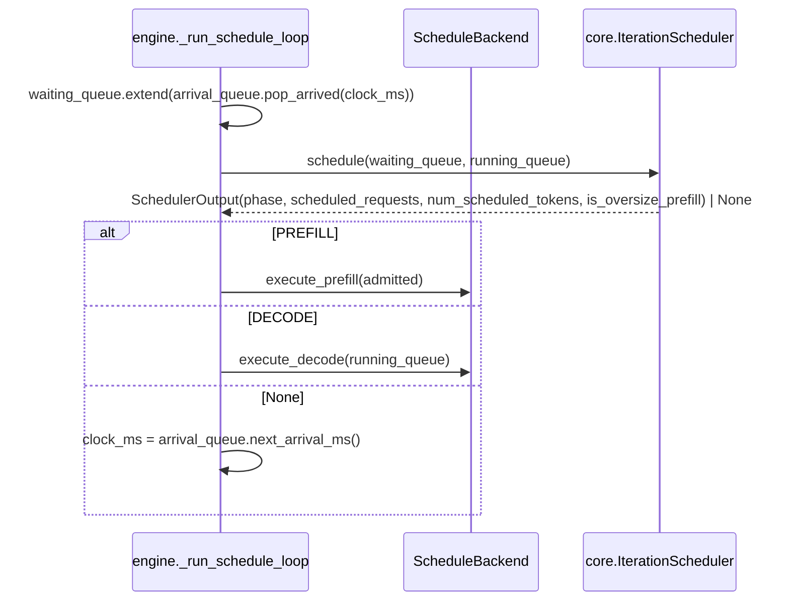

# 迭代级调度策略 (Iteration-level Scheduling Policy)

> 本文描述 `core.IterationScheduler` 每一步「执行 Prefill 还是 Decode、哪些请求入场」的决策逻辑。队列、batch slot 与 KV Cache 的机制见 [Continuous Batching](continuous-batching.md) 与 [Paged KV Cache](paged-kv-cache.md)。

---

## 一、入场决策收敛于 `IterationScheduler.schedule`

调度主循环（`engine/scheduler_loop.py`）每一步按以下顺序执行：



- **`IterationScheduler(scheduler_config, batching_method, kv_cache_manager)`**（纯 CPU control plane）在 `schedule()` 内一次完成全部入场决策，依次在 WaitingQueue 的 FCFS 前缀上取交集：
  1. batching 约束：continuous-batching 有 free batch slot 即可入场；fixed-batching / none 须等 RunningQueue 排空（wave barrier）；
  2. batch slot 约束：至多 `RunningQueue.num_free_batch_slots` 个；
  3. KV 显存约束（仅 Paged，`kv_cache_manager` 非 None）：`KVCacheManager.num_admissible` 可容纳的前缀；
  4. 策略约束：token budget 截断与 decode protection（见下文）。
- 所有约束都是 **FCFS 前缀截断**，可交换、可组合；**不跳过队头**：队头放不下就停，不往后找更短的请求（与 vLLM V1 一致）。
- **到达过滤**由 engine 主循环按逻辑时钟完成（engine 层持有时钟），WaitingQueue 只含已到达请求，故 `schedule()` 无需 `clock_ms`；`ScheduleBackend` 只负责执行与资源回收（`KVCacheManager` 仍由 Paged 后端持有，`IterationScheduler` 只读查询）。

## 二、scheduler config

通过 `EngineConfig.scheduler_config` 选择策略（判别式联合 `SchedulerConfig`，与 `KVCacheConfig` 同构）：

| 配置 | scheduling policy | 行为 |
|---|---|---|
| `PrefillFirstConfig()`（默认） | `prefill-first` | 入场上限内的 FCFS 前缀整批 Prefill；无可入场请求才 Decode |
| `TokenBudgetConfig(token_budget)` | `token-budget` | 入场上限内再按 token budget 截断 FCFS 前缀，并启用 decode protection |

约束（`validate_engine_config` 与 `run_scheduler` 校验）：

- `token-budget` 仅支持 `continuous-batching`（fixed 的 wave barrier 与 none 串行不存在跨步入场决策）。
- `token_budget ≥ max_running_requests`（`run_scheduler` 按实际生效的并发上限再校验一次），否则一次完整 Decode 即超预算（对标 vLLM `max_num_batched_tokens ≥ max_num_seqs`）。
- 默认 `prefill-first` 不进入 `str(EngineConfig)`，历史 Record 的 `engine_config` 标识不变；`token-budget` 追加 `+token-budget(token_budget=N)` 后缀。

## 三、token-budget 策略

### 1. 成本模型：padded prompt tokens

本地 Batched Prefill 采用左 Padding，实际送入模型的 Token 数为 `len(batch) × max(prompt_len)`。vLLM 用 varlen 拼接、按真实 Token 计费；此处按 padded prompt tokens 计费才能反映 Compute-Bound Prefill 的真实开销。该值即 `SchedulerOutput.num_scheduled_tokens`（DECODE 时为运行中请求数），经 `ScheduleEvent.num_scheduled_tokens` 透传给 `summarize_schedule` 计算 `padding_efficiency`，是 padded prompt tokens 的单一事实源。

### 2. 软预算与 oversize prefill

无 Chunked Prefill 时长 Prompt 无法拆分。若队头请求单独已超预算，则让它独自 Prefill（oversize prefill），保证 FCFS 队列一定有进展。因此：非 oversize 的 Prefill 满足 `num_scheduled_tokens ≤ token_budget`；oversize Prefill 只含 1 个请求，并以 `SchedulerOutput.is_oversize_prefill` 标记，经 `ScheduleEvent.is_oversize_prefill` 透传。

### 3. decode protection

RunningQueue 非空且上一步是 PREFILL 时，强制执行一步 DECODE。本地无法把 Prefill 与 Decode 放进同一次前向，只能用相位交替近似 vLLM V1「先排 running、再排 waiting」的做法，限制 Prefill burst 对在途请求 ITL 的冲击。

示例（6 个同时到达的 3-token 请求，`max_running_requests=4`，`token_budget=6`）：

| 步 | prefill-first | token-budget |
|---|---|---|
| 1 | PREFILL [0, 1, 2, 3]（12 tokens） | PREFILL [0, 1]（6 tokens） |
| 2 | DECODE | DECODE（decode protection） |
| 3 | DECODE | PREFILL [2, 3]（6 tokens） |

## 四、迭代调度步数类指标

`summarize_schedule` 由事件流汇总到 `ScheduleMetrics`（Record 中为 `schedule.*`，多轮测量聚合为 `DistributionStats`）：

| 指标 | 含义 |
|---|---|
| `num_prefill_steps` / `num_decode_steps` | PREFILL / DECODE 事件数 |
| `max_consecutive_prefill_steps` | 最长连续 PREFILL 事件数：衡量 Prefill burst 对在途 Decode 的阻塞；token-budget 在 RunningQueue 非空时恒为 1（decode protection） |
| `num_oversize_prefill_steps` | oversize prefill 事件数：预算过小（或长 Prompt 过多）时偏高 |

早于 token-budget 的历史 Record 无这些字段，Schema 中为 `Optional`（不回填），绘图与报告缺失时跳过。

## 五、不变量与验证

- 两种策略只决定「谁在哪一步入场」，`position_ids`、block table 寻址与因果可见范围仍由 worker 保证，逐请求输出与串行 `generate` 逐 Token 一致。
- CPU：`tests/unit/test_scheduler.py`（决策单测）、`test_continuous.py` / `test_paged_scheduler.py`（串行一致性与事件不变量）、`test_compare_schedulers.py`、`mini-infra verify smoke`（`check_token_budget_scheduling`）。
- GPU：`mini-infra verify schedulers-token-budget`（`compare_schedulers_token_budget.py` 错峰 Burst 轨迹与指标对比）与 `tests/gpu/parity/test_scheduler_batch_parity.py` 在 `float32` 下覆盖 Dense / Paged × 预算（含 oversize prefill）。

## 六、使用

```bash
# 单独启用 token-budget
mini-infra run --batching-method continuous-batching --caching-method paged-kv-cache \
  --scheduling-policy token-budget --token-budget 256 --max-running-requests 4

# 对比 prefill-first 与 token-budget
mini-infra run --batching-method continuous-batching \
  --compare-feature scheduling-policy prefill-first token-budget --token-budget 256 \
  --max-running-requests 4
```

```python
from mini_infra import BatchingMethod, EngineConfig, PagedCacheConfig, TokenBudgetConfig

config = EngineConfig(
    PagedCacheConfig(block_size=16),
    batching_method=BatchingMethod.CONTINUOUS,
    max_running_requests=4,
    scheduler_config=TokenBudgetConfig(256),
)
```

受控实验套件 `prefill-first-vs-token-budget-prefill-burst`（YAML 的 `scheduler_spec` 扫描轴与 `caching_spec` 同构，见 [声明式评测规范](../benchmarks/spec-schema.md)）：

```bash
mini-infra bench sweep --engine scheduler --tag dev --suite prefill-first-vs-token-budget-prefill-burst \
  --output tmp/results/prefill-burst.local.json
mini-infra bench scheduler case --tag dev --caching-method paged-kv-cache --max-running-requests 8 \
  --scheduling-policy token-budget --token-budget 512 --prompt-lens 128 2048 128 1024 --arrival-times-ms 0 0 50 50
```
