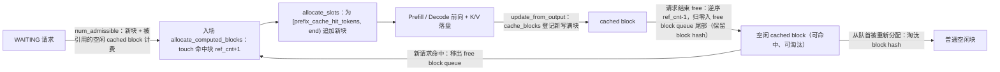

# Paged KV Cache（physical block pool + block table）

[`DenseSlotCache`](continuous-batching.md) 为每个 batch slot 预留 `[capacity, H_kv, length, D]` 的稠密矩形，`length` 取全局最长序列：短请求被迫携带 Padding，长请求入场触发整块左侧扩容（`torch.cat` 拷贝），Decode 恒以 `capacity` 行执行。Paged KV Cache 参考 vLLM V1，把显存切成定长 physical block，请求只持有「logical block → physical block 号」的映射（block table）。

## 一、分层与职责

| 层 | 模块 | 职责 |
|---|---|---|
| ③ Core（CPU） | [`core/block_manager.py`](../../src/mini_infra/core/block_manager.py) | `FreeKVCacheBlockQueue`（free block queue，FIFO 空闲队列，block 0 为 null block）、`BlockPool`（引用计数与 cached block 索引）、`KVCacheManager`（请求级 block table、按需追加 physical block、整体释放引用、prefix caching）。纯 Python，无 `torch`。 |
| ④ Worker（GPU） | [`worker/paged_block_cache.py`](../../src/mini_infra/worker/paged_block_cache.py) | `PagedBlockCache`：逐层 physical block pool，只认 `physical_block_id` / physical slot（token 级物理位）。 |
| ④ Worker（GPU） | [`worker/paged_runner.py`](../../src/mini_infra/worker/paged_runner.py) | `PagedRunner`：Host 侧批量组装 `slot_mapping` / `block_tables` / `context_lens`，单次 H2D；Prefill 后散写 physical block pool。 |
| ⑤ Model | [`model/qwen3.py`](../../src/mini_infra/model/qwen3.py) | `forward`（支持 `attn_metadata=PagedAttentionMetadata`）：只接收裸张量（physical block pool + `PagedAttentionMetadata`），就地写入新 K/V、按 block table 读取历史。 |
| ② Engine | [`engine/paged_schedule_backend.py`](../../src/mini_infra/engine/paged_schedule_backend.py) | `PagedScheduleBackend`：与 Dense 路径共享统一调度主循环（三级队列 + FCFS/Prefill 优先规则），仅替换 KV 存储与读取方式。 |

## 二、张量契约

```text
key_pool / value_pool: [num_blocks, block_size, num_kv_heads, head_dim], model dtype, contiguous（每层一对，vLLM 布局）
slot_mapping:          [batch]              long   physical_block_id * block_size + offset（本步新 Token 的写入 physical slot）
block_tables:          [batch, max_blocks]  long   logical block -> physical block，右侧以 null block(0) 补齐
context_lens:          [batch]              long   含本步新 Token 的有效上下文长度
```

- physical block pool 整池零初始化，释放的 block **不清零**：读取经 `context_lens` 构造的加性掩码屏蔽，且池内恒为有限值，避免 `0 × NaN`。
- Decode 只执行活跃请求，无 Padding 行（`physical_batch_size == num_active_requests`）；请求结束仅归还 physical block 号，不移动其他请求数据。
- 按 block table 取块（`key_pool[block_tables]`）的结果天然连续，`view` + `transpose` 以非连续视图直接喂 `matmul`，不触发 `contiguous()`。
- Prefill 沿用 Dense 路径的左 Padding 前向（数值同源），再每层一次 `index_copy_` 把有效 Token 散写入各请求的 physical block；该开销计入 `cache_management_ms`。

## 三、使用

```python
EngineConfig(
    kv_cache_config=PagedCacheConfig(block_size=16, num_blocks=None),  # None：按工作负载推导
    batching_method=BatchingMethod.CONTINUOUS,
)
```

```bash
# 1. Dense batch slot vs Paged（同一调度策略，唯一变量是 KV 存储）
mini-infra run --batching-method continuous-batching --compare-feature caching-method dense-kv-cache paged-kv-cache --kv-block-size 16

# 2. 单用例基准测试（指定 block size 并以连续批处理驱动）
mini-infra bench scheduler case --tag dev --caching-method paged-kv-cache --batching-method continuous-batching --block-size 16 --max-running-requests 4

# 3. 运行 Dense vs Paged 受控对比套件（自动评估 makespan_speedup、output_throughput_gain、accessed_kv_cache_tokens_reduction 与 peak_kv_cache_pool_reduction）
mini-infra bench sweep --engine scheduler --tag dev --suite dense-vs-paged-long-short-stress
mini-infra bench sweep --engine scheduler --tag dev --suite dense-vs-paged-length-ratio
mini-infra bench sweep --engine scheduler --tag dev --suite dense-vs-paged-block-size
```

默认 physical block pool 大小为「最长的 `max_running_requests` 个请求的峰值 Token（`prompt + max_new - 1`）所需 physical block 数之和 + null block」，保证不会耗尽。

## 四、Prefix Caching（自动前缀缓存）

功能覆盖参考实现 [chapter_08](https://github.com/SVDX-lab/miniinfra/tree/main/chapter_08)（`paged_cache.py` / `scheduler.py` / `engine.py` / `run_inference.py`）。由 `PagedCacheConfig.is_prefix_caching_enabled` 开启（默认关闭，关闭时行为与 Baseline 完全一致）。

### 1. 数据结构（`core/block_manager.py`，纯 CPU）

| 规范名 | 代码锚点 | 说明 |
|---|---|---|
| block hash | `BlockHash(hash_value, token_ids)` / `hash_block_tokens` | 满块的链式哈希：`hash((parent.hash_value, token_ids))`，覆盖从 Prompt 开头到本块的整段前缀；`token_ids` 参与字典等值比较，末块内容不同的 hash 碰撞不会误命中 |
| cached block | `KVCacheBlock.block_hash` / `BlockPool._cached_block_id_by_hash` | K/V 已写满并登记 block hash 的 physical block，可被多个请求共享（`KVCacheBlock.ref_cnt` > 1） |
| computed blocks | `KVCacheManager._get_computed_blocks` | 新请求 Prompt 沿 block hash 链匹配到的最长 cached block 前缀；最多 `(prompt_len - 1) // block_size` 块，保证至少 1 个 Prompt Token 前向以产出首 Token logits |
| prefix_cache_hit_tokens | `RequestState.prefix_cache_hit_tokens` / `SequenceOutput.prefix_cache_hit_tokens` | 入场时 prefix cache 命中、跳过 Prefill 计算的 Token 数（恒为 `block_size` 整数倍） |

### 2. 生命周期



- **先计算后登记**：Prefill 的历史 K/V 在前向前经 `gather_blocks` 读取、本步 K/V 在前向后散写，因此满块只在本步落盘后（`IterationScheduler.update_from_output`）登记；同一步内多个共享前缀的新请求各自计算，第二个起的重复块不登记、作为私有块随请求释放。
- **Decode 块也会登记**：Decode 写满一个块时以「Prompt + 已写 K/V 的生成 Token」计算 block hash，多轮对话下一轮 Prompt（= 上一轮 Prompt + 输出 + 新问题）可命中上一轮 Decode 产生的块。
- **惰性 LRU 淘汰**：cached block 只占用空闲块，不额外扩大 physical block pool（同等显存下与 Baseline 公平对照）；free block queue 次序即 LRU 次序，请求结束时逆序释放使尾块先被淘汰、公共前缀根块存活更久。需要更大的缓存容量时显式调大 `num_blocks`（对应 chapter_08 的 `prefix_cache_capacity_blocks`）。
- **原子入场**：同一步新入场请求先全部 `allocate_computed_blocks`（引用命中块）再统一 `allocate_slots`，避免前一请求的新块分配从队首淘汰后一请求已规划命中的空闲 cached block。
- **调度联动**：所有 batching policy 下新请求的 Prefill 区间都从命中长度起算（`PrefillChunk.start == prefix_cache_hit_tokens`），命中部分不计入 token budget / padded token 计费；Worker 侧沿用 chunked prefill 的「历史 K/V 经 block table 读回」路径，零改动。
- **请求隔离**：命中长度块对齐，新 K/V 只写入位置 `≥ prefix_cache_hit_tokens` 的私有块；cached block 只读共享，不存在跨请求写污染。

### 3. 指标

`PagedCacheProfile`（落盘为 `memory.kv_cache.paged_cache`）新增 `prefix_cache_prompt_tokens` / `prefix_cache_hit_tokens` 与 `prefix_cache_block_eviction_count`；`padding_efficiency` 的分子改为实际参与前向的 Prompt Token 数（扣除命中部分，未启用时不变）。

### 4. 使用

```python
EngineConfig(
    kv_cache_config=PagedCacheConfig(block_size=16, is_prefix_caching_enabled=True),
    batching_method=BatchingMethod.CONTINUOUS,
    scheduler_config=SchedulerConfig(max_running_requests=1, batching_policy=ChunkedPrefillConfig(64)),
)
```

```bash
# 对应 chapter_08 run_inference.py：共享长背景的两条请求，对照 prefix caching 关闭 / 开启
SHARED="请先阅读以下共同背景：Prefix Cache 会复用多个请求相同前缀已经计算出的 KV Cache，从而减少后续请求的 Prefill 计算。"
mini-infra run \
  --caching-method paged-kv-cache --kv-block-size 16 \
  --batching-method continuous-batching --max-running-requests 1 \
  --batching-policy chunked-prefill --token-budget 64 --max-new-tokens 16 \
  --prompts "${SHARED}${SHARED}${SHARED}${SHARED} 现在请用一句话概括它的主要收益。" \
            "${SHARED}${SHARED}${SHARED}${SHARED} 现在请用一句话说明它的显存代价。" \
  --compare-feature prefix-caching disabled enabled

# float32 真实权重正确性对照（输出一致、首 Token Logits 误差、Prefill 计算量）
mini-infra verify prefix-caching
```

## 五、与 vLLM 的差异（已知限制）

- 未实现抢占（Preemption）：显式指定过小的 `num_blocks` 时，入场按「Prompt 所需 physical block」受限（FCFS 前缀），但并发增长耗尽 physical block pool 会抛出 `RuntimeError`，不会静默出错。
- Prefix caching 的 block hash 采用 Python 内建 `hash`（进程内确定，cache 生命周期为单次 `run_scheduler`），不含 LoRA / 多模态 extra keys；同一步重复计算的块不去重（同一 block hash 只保留首个登记的 physical block）。
- 当前仅支持 `continuous-batching` 与 `fixed-batching`；None 批处理与 `paged-kv-cache` 组合会被拒绝。
- Attention 为纯 PyTorch 的「按 block table gather 后做稠密 Attention」，无融合 Paged Attention Kernel；每层会拷贝一次上下文。
- 历史发版基准数据（`benchmarks/results/history/`）对齐受控发版计划维护，`bench scheduler` 已完整集成 Paged KV Cache 单用例与对比套件（prefix caching 受控对比套件尚未接入）。

## 六、验证

```bash
pytest tests/unit/test_block_manager.py tests/unit/test_paged_block_cache.py tests/unit/test_paged_scheduler.py tests/unit/test_prefix_caching.py
mini-infra verify batch-scheduler   # float32：serialized / fixed / continuous / paged 逐 Token 一致
mini-infra verify prefix-caching    # float32：prefix caching 关闭 / 开启逐 Token 一致、首 Token Logits atol <= 1e-4
```
