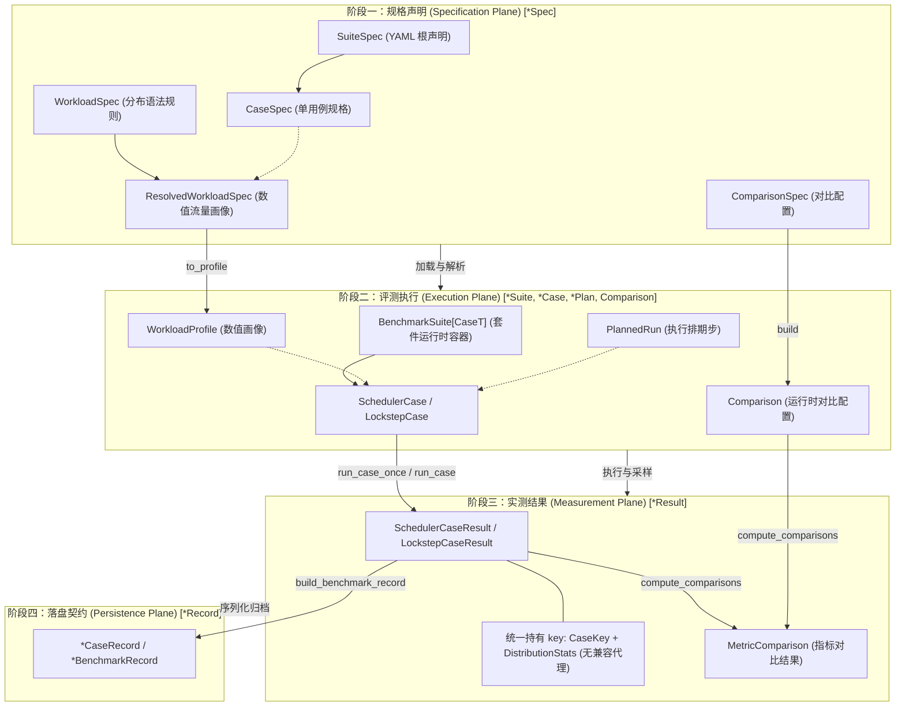

# 基准测试与性能评测指南 (Benchmarking Guide)

本指南系统汇总了 [`src/mini_infra/bench/`](../../src/mini_infra/bench/) 模块提供的全部基准测试、套件压测、图表绘制与性能回归守门指令，供日常性能调优与版本发版参考。

---

## 一、Benchmark 命令全景速查

| 一级分类 | 子命令 | 核心执行函数 / 模块 | 核心用途 | 默认输出路径 |
| :--- | :--- | :--- | :--- | :--- |
| **Lockstep 齐步** | `mini-infra bench lockstep case` | `lockstep/run_case.py` | 运行单用例无调度器推理（单请求 Baseline/KV Cache 或固定批处理） | `benchmarks/results/history/lockstep/` 或 `--output` |
| **scheduler 调度器** | `mini-infra bench scheduler case` | `scheduler/run_case.py` | 运行单用例动态调度服务化推理（Fixed vs Continuous、Dense vs Paged，支持并发与错峰到达） | 控制台输出或 `--output` |
| **Suite 检视** | `mini-infra bench suites list \| show \| schema` | `spec/` | 浏览内置 suite、查看合并后的 YAML 与展开用例、导出 JSON Schema（无需 GPU） | 标准输出 |
| **Suite 运行 / 扫描** | `mini-infra bench sweep` | `sweep.py` | 运行单个或批量 suite（`--suite A [B...]` / `--spec P...` / `--all`），共享模型加载与正确性检查，支持 `--set` 覆盖并汇总产物与对比；单 suite 支持 `--output` | `--output`、`--output-dir` 或各 suite 默认目录 |
| **Release 固化** | `mini-infra bench release` | `cli/commands/bench/release.py` | 按标准多规模负载（small/medium/large）一键生成版本基准、报告与回归基线 | `benchmarks/results/history/{lockstep,scheduler}/` |
| **Plot 绘图** | `mini-infra bench plot history` | `plotting/history.py` | 读取所有历史发版数据，生成跨版本演进时间线图与深度 Profiling 报告 | `benchmarks/reports/{lockstep,scheduler}/` |
| | `mini-infra bench plot compare` | `plotting/compare.py` | 对比任意两个独立 JSON 实验结果，绘制柱状对比图与 Markdown 差异表 | `./benchmark_comparison.png` |
| **Regression 守门** | `mini-infra bench check-regression` | `check_regression.py` | 1 分钟轻量级冒烟比对，拦截 TTFT/TPOT 劣化超过 5% 的代码变更 | `benchmarks/candidate.local.json` |

---

## 二、评测系统架构与四阶段生命周期 (Bench System Architecture)

评测系统采用分层解耦架构，数据流严格遵循「规格声明 $\to$ 评测执行 $\to$ 实测结果 $\to$ 落盘契约」单向流动：



### 核心设计原则与架构不变量

1. **规格与执行严格解耦（Specification vs Execution）**
   - **规格声明层（Specification Plane）**：全部以 `*Spec` 命名（如 `SuiteSpec`、`CaseSpec`、`WorkloadSpec`、`ResolvedWorkloadSpec`、`ComparisonSpec`）。纯粹负责 YAML 反序列化、分布展开与参数合法性校验，零 Token 序列依赖，不触碰执行逻辑。
   - **评测执行层（Execution Plane）**：套件由统一泛型基类 `BenchmarkSuite[CaseT]` 承载；通过 `ComparisonSpec.build()` 构建运行时对比对象 `Comparison`；用例实体 `SchedulerCase` 与 `LockstepCase` 对齐持有 `key: CaseKey` 与轻量数值画像 `profile: WorkloadProfile`；套件展开 `suite.cases()` 彻底与词表大小和设备解耦，具体 Token 序列仅在底层执行函数中按需局部材质化（Materialize on Demand）。
2. **流量画像单一真相源（SSOT）**
   - 彻底废除重复冗余的 `Workload` 类，全仓统一以 `ResolvedWorkloadSpec` 展开为 `WorkloadProfile` 作为唯一权威数值流量画像。
   - 显式字段 `num_total_requests: int` 与请求级列表（`prompt_lens`、`output_budgets`、`arrival_ms`）严格校验守恒；运行时仅在 `run_case` 执行入口按需材质化为局部 `RequestSpec`，彻底杜绝纯数字画像与具体 Token 载荷的混淆与内存常驻。
3. **两套引擎绝对结构对称（Two-Engine Symmetry）**
   - `Lockstep` 与 `Scheduler` 在套件抽象（`BenchmarkSuite[CaseT]`）、数值画像（`WorkloadProfile`）、执行分层（原子 `run_case_once` 与统计多轮 `run_case`）、以及结果身份凭证（`key: CaseKey`）上保持 100% 对齐。
   - 杜绝向后兼容包袱（严格遵循 YAGNI）：不保留兼容代理属性（如 `res.mode`），所有调用点直接访问规范路径 `res.key.mode`。

### 核心类型与生命周期映射表

| 生命周期阶段 | 核心类型 / 函数 | 命名规范 | 职责边界 |
| :--- | :--- | :--- | :--- |
| **阶段一：规格声明** | `SuiteSpec` / `CaseSpec` / `ResolvedWorkloadSpec` / `ComparisonSpec` | `*Spec` | YAML 声明解析、场景展开与参数校验，无状态与纯数值元数据 |
| **阶段二：评测执行** | `BenchmarkSuite[CaseT]` / `SchedulerCase` / `LockstepCase` / `Comparison` / `WorkloadProfile.to_payload` | `*Suite`, `*Case`, `Comparison`, `to_payload` | 运行时套件容器、轻量用例定义、对比策略、单步执行排期与按需局部载荷装配 |
| **阶段三：实测结果** | `run_case_once` / `run_case` / `SchedulerCaseResult` / `LockstepCaseResult` / `MetricComparison` | `run_case*`, `*Result`, `MetricComparison` | 单次/多轮测量采样、时钟打点、指标聚合与统计中位数比对 |
| **阶段四：落盘契约** | `LockstepBenchmarkRecord` / `SchedulerBenchmarkRecord` / `save_benchmark_record` | `*Record` | Pydantic v2 Schema 校验、JSON 序列化与历史基准归档 |

---

## 三、Lockstep 齐步基准测试 (`bench lockstep`)

面向**无队列调度器**的推理底座（基于 `generate` / `lockstep_loop`），覆盖单请求与整批同步前向（Fixed Batching）。

### 1. 单用例测试 (`lockstep case`)
用于快速测量某个特定 Prompt 长度、批大小或预算配置下的精确延迟与显存。参数遵循 NumPy 式广播规则。

#### 常用命令样例
```bash
# 1. 基础单请求测试（batch=1, prompt=128, max_new_tokens=64，默认启用 KV Cache）
mini-infra bench lockstep case \
  --tag dev

# 2. 对比无 KV Cache（Baseline）模式
mini-infra bench lockstep case \
  --tag dev \
  --no-kv-cache

# 3. 固定批处理等长压测（batch=4, prompt=128, max_new_tokens=32）
mini-infra bench lockstep case \
  --tag dev \
  --batch-size 4 \
  --prompt-lens 128 \
  --max-new-tokens 32 \
  --batching-method fixed-batching

# 4. 变长输入测试（自动根据 4 个 Prompt 长度推断 batch_size=4）
mini-infra bench lockstep case \
  --tag dev \
  --prompt-lens 16 32 64 128 \
  --max-new-tokens 32 \
  --batching-method fixed-batching

# 5. 开启硬件级 Profiling（采集 MBU、MFU 及 CUDA 算子耗时归因）
mini-infra bench lockstep case \
  --tag profile \
  --profile-mode extra-profile \
  --output tmp/profile.json
```

---

### 2. 预设实验套件 (`bench sweep --engine lockstep`)
通过系统扫描关键超参数，探索硬件与批处理策略的扩展边界。所有 suite 统一经 `mini-infra bench sweep` 执行。

#### 注册套件清单
1. **`serial-vs-fixed-batch-throughput`**：扫描 Batch Size 1, 2, 4, 8, 16，对比单请求串行与固定批处理的吞吐与显存增长曲线。
2. **`uniform-vs-variable-prompt-padding`**：固定 Batch Size 4，对比等长 Prompt 与阶梯变长 Prompt（16, 32, 64, 128），测量 Padding 有效率与 Prefill 算力浪费。
3. **`uniform-vs-variable-budget-slots`**：固定 Batch Size 4，对比等长生成预算与阶梯变长预算（8, 16, 32, 64），测量短请求提前退出导致的 batch slot 闲置浪费。

#### 常用命令样例
```bash
# 预览用例列表（无需 GPU，Dry-Run）
mini-infra bench sweep --engine lockstep \
  --tag dev \
  --suite serial-vs-fixed-batch-throughput \
  --dry-run

# 运行固定批处理吞吐扩展套件（单 suite 可用 --output 指定输出路径）
mini-infra bench sweep --engine lockstep \
  --tag dev \
  --suite serial-vs-fixed-batch-throughput

# 运行变长 Prompt 输入的 Padding 损耗套件
mini-infra bench sweep --engine lockstep \
  --tag dev \
  --suite uniform-vs-variable-prompt-padding

# 运行变长输出预算的 batch slot 利用率套件
mini-infra bench sweep --engine lockstep \
  --tag dev \
  --suite uniform-vs-variable-budget-slots
```

> [!NOTE]
> 套件的 `warmup` / `repeats` 取自 YAML 的 `execution`，命令行 `--warmup` / `--repeats` 仅在显式传入时覆盖。

---

## 四、scheduler 调度器基准测试 (`bench scheduler`)

面向**服务化与队列调度**架构（基于 `run_scheduler`），具备三级队列、动态准入、EOS 退出、`DenseSlotCache`（batch slot 管理）与 `PagedKVCachePool`（physical block pool 管理）。

### 1. 单用例服务化测试 (`scheduler case`)
模拟带有并发上限（Concurrency Limit）、请求到达时序与不同 KV Cache 存储方案的服务端负载。

#### 常用命令样例
```bash
# 1. 连续批处理（Continuous Batching）标准单用例（并发上限 4，请求总数 8）
mini-infra bench scheduler case \
  --tag dev \
  --batching-method continuous-batching \
  --max-running-requests 4 \
  --request-count 8 \
  --prompt-length 128 \
  --output-budget 32

# 2. 相同负载下的固定批处理（Fixed Batching）波次对照组
mini-infra bench scheduler case \
  --tag dev \
  --batching-method fixed-batching \
  --max-running-requests 4 \
  --request-count 8 \
  --prompt-length 128 \
  --output-budget 32

# 3. 错峰到达测试（模拟每间隔 20ms 到达一个新请求）
mini-infra bench scheduler case \
  --tag dev \
  --batching-method continuous-batching \
  --arrival-interval-ms 20.0 \
  --max-running-requests 4 \
  --request-count 12

# 4. Paged KV Cache 单用例测试（指定 physical block 大小为 32，块池自动按负载推导）
mini-infra bench scheduler case \
  --tag dev \
  --caching-method paged-kv-cache \
  --batching-method continuous-batching \
  --block-size 32 \
  --max-running-requests 4 \
  --request-count 8 \
  --prompt-length 128 \
  --output-budget 32
```

---

### 2. 预设调度器套件 (`bench sweep --engine scheduler`)
评估连续批处理在复杂线上工况相对固定批处理的加速比，以及 Paged KV Cache 相对 Dense 路径在显存占用与 KV 访问上的优化收益。所有 suite 统一经 `mini-infra bench sweep` 执行。

#### 注册套件清单

**Fixed vs Continuous 对比套件（默认交替维度 `interleave=(batching_method,)`）**：
1. **`fixed-vs-continuous-variable-output-length`**：长短请求混跑（输出长度极不均衡）。连续批处理在短请求退出后立即释放 batch slot 并接纳新请求，展现最大吞吐优势。
2. **`fixed-vs-continuous-uniform-output-length`**：所有请求输出等长基准，作为无长尾效应时的底线对比。
3. **`fixed-vs-continuous-staggered-arrivals`**：请求按时间阶梯陆续到达，考察连续批处理的即到即调度能力 vs 固定批处理的攒批排队延迟。
4. **`fixed-vs-continuous-prefill-interference`**：运行中 Decode batch slot 受新入场请求 Prefill 插入时的 ITL 抖动与打断开销。

**Dense vs Paged 对比套件（默认交替维度 `interleave=(caching_method, paged_cache_config)`）**：
5. **`dense-vs-paged-long-short-stress`**：长短 Prompt 混杂受控压力测试（long=2048），对比 Dense batch slot 与 Paged 物理块池的峰值显存、KV 读取数与调度延迟。
6. **`dense-vs-paged-length-ratio`**：长短 Prompt 长度比扫描（长 Prompt 取 128 / 512 / 2048 / 3072），评估非均匀 Prompt 长度分布下 Paged KV Cache 的显存与吞吐收益变化趋势。
7. **`dense-vs-paged-block-size`**：Paged 物理块大小扫描（8 / 16 / 32 / 64），对比不同 block size 下的显存开销与调度吞吐，共用同一 Dense 基线。

> [!NOTE]
> 与 lockstep 一致：套件的 `warmup` / `repeats` 取自 YAML 的 `execution`，命令行 `--warmup` / `--repeats` 仅在显式传入时覆盖。

#### 常用命令样例
```bash
# 1. 运行长短请求混跑对比套件（推荐：最能体现 Continuous Batching 优势的场景；单 suite 可用 --output 指定输出路径）
mini-infra bench sweep --engine scheduler \
  --tag v0.4.0 \
  --suite fixed-vs-continuous-variable-output-length

# 2. 运行长短 Prompt 受控压力测试套件（Dense vs Paged 对比）
mini-infra bench sweep --engine scheduler \
  --tag v0.5.0 \
  --suite dense-vs-paged-long-short-stress

# 3. 运行 block size 扫描套件
mini-infra bench sweep --engine scheduler \
  --tag v0.5.0 \
  --suite dense-vs-paged-block-size

# 4. 自定义交替轮换维度（可选: workload_id, caching_method, batching_method, flags, max_running_requests, paged_cache_config）
mini-infra bench sweep --engine scheduler \
  --tag v0.5.0 \
  --suite dense-vs-paged-block-size \
  --interleave caching_method paged_cache_config

# 5. 预览执行计划（无需 GPU，Dry-Run 模式毫秒级验证调度计划）
mini-infra bench sweep --engine scheduler \
  --tag test \
  --suite dense-vs-paged-block-size \
  --dry-run
```

> [!TIP]
> **热漂移规避（Thermal Drift Mitigation）与声明式对比**：
> `bench sweep --engine scheduler` 内建了基于 `CaseDimension` 的交替执行机制（Run Alternation），在奇偶轮次反转对比维度的执行顺序，并在每次运行间强制调用 `gc.collect()` 与 `torch.cuda.empty_cache()`。套件运行结束后自动计算中位数相对指标（Makespan 加速比、吞吐增益、KV 读取削减、显存削减）并输出列对齐终端摘要。

---

## 五、性能图表绘制与对比分析 (`bench plot`)

### 1. 跨版本演化全景图 (`plot history`)
读取 `benchmarks/results/history/{lockstep,scheduler}/*.json` 下积累的所有历史版本数据，重新绘制时间线演进大图与 Markdown 汇总报表。

```bash
# 读取历史数据并生成汇总报表与两大演进图
mini-infra bench plot history

# 产出文件（按 lockstep 与 scheduler 分域生成）：
# 1. benchmarks/reports/{lockstep,scheduler}/SUMMARY.md (Markdown 全景汇总表)
# 2. benchmarks/reports/{lockstep,scheduler}/evolution_and_scaling.png (跨版本加速比与长度扩展曲线)
# 3. benchmarks/reports/{lockstep,scheduler}/profiling_and_optimization.png (当前最新版本的 MBU/MFU 与算子剖析)
```

---

### 2. 任意两版本独立对比图 (`plot compare`)
日常调优时，直接对比任意两个独立的测试结果 JSON（无需沉淀到正式历史目录）。

```bash
# 对比当前实验结果与 Baseline
mini-infra bench plot compare \
  benchmarks/results/history/lockstep/915b0d9_v0.1.0.json \
  tmp/profile.json \
  --output-figure tmp/comparison.png \
  --output-markdown tmp/comparison.md \
  --title "KV Cache vs Baseline 性能对比"
```

---

## 六、轻量性能回归守门 (`bench check-regression`)

作为 CI 门禁与 Pre-push Hook 的核心守门工具，耗时约 1 分钟，现场运行轻量 Benchmark 并与 `benchmarks/golden/reference.json` 比对。

```bash
# 1. 日常快速守护检查（TTFT 或 TPOT 劣化超过 5% 时报错退出）
mini-infra bench check-regression

# 2. 严格硬件匹配（非同一型号 GPU 时直接报错拦截，用于云端 CI）
mini-infra bench check-regression --strict-hardware

# 3. 新特性发布时固化当前性能底线（更新 benchmarks/golden/reference.json）
mini-infra bench check-regression --update-reference
```

---

## 七、声明式 Suite（YAML）：新增与检视

所有 suite 均由 [`benchmarks/specs/{lockstep,scheduler}/<name>.yaml`](../../benchmarks/specs/) 声明；**新增 suite = 新增一个 YAML 文件，无需改 Python**。`name` 必须与文件名一致，`_bases/` 下的文件仅供 `extends` 复用、不可直接运行。

```yaml
# benchmarks/specs/scheduler/fixed-vs-continuous-staggered-arrivals.yaml
# yaml-language-server: $schema=../suite.schema.json
name: fixed-vs-continuous-staggered-arrivals
extends: _bases/fixed_vs_continuous.yaml     # 映射深合并，列表整体替换
workload:
  id: staggered_arrivals                     # → CaseKey.workload_id
  count: 8
  prompt_len: 128
  output_len: {alternating: [8, 32]}
  arrival_ms: {interval: 150}
```

| 配置块 | 作用 |
| :--- | :--- |
| `engine` | `scheduler` 或 `lockstep`，决定 system 允许的键与 case 类型 |
| `execution` | `warmup` / `repeats` / `interleave`（scheduler 交替维度，取值为 `CaseDimension`） |
| `system` | 被测系统：`batching_method[]` × `caching_method[]`（× `paged.block_size`）与 `max_running_requests`（仅 scheduler） |
| `workload` | `id`、`vars`，以及 `groups`（或单组简写 `count / prompt_len / output_len / arrival_ms`）；值中可用 `${var}`；随机分布需要 `seed`（可选 `seed_salt`） |
| `sweep` | `workload`：dict-of-lists 为笛卡尔积，list-of-dicts 为显式场景；`system`：`block_size` / `max_running_requests` |
| `comparison` | scheduler 专用：`group_by` / `baseline` / `metrics`（`speedup` \| `gain` \| `reduction`） |
| `checks` | 具名语义守卫：`free_batch_slot_at_t0`、`min_max_running_requests: N`、`min_output_len: N` |

**长度与到达分布**：`prompt_len` / `output_len` 取标量（constant；lockstep 中保持标量广播语义）、列表（逐请求 explicit，须等于 `count`）、`{alternating: [a, b]}`、`{ladder: {max: M, floor: F}}`（`count` 必须为 4，取 `[M//8, M//4, M//2, M]` 并以 `F` 为下限）；`arrival_ms` 取标量、列表或 `{interval: ms}`。

**随机分布（确定性伪随机）**：`prompt_len` / `output_len` 还支持 `{log_uniform: {min, max}}`（分层对数均匀 + 打乱，模拟短/中请求居多的长尾分布），`arrival_ms` 还支持 `{poisson: {initial_burst, mean_interval_ms}}`（前 `initial_burst` 个同时到达，其后为指数间隔，夹在 [5, 3×均值] ms）。使用它们必须提供 `workload.seed`：所有随机分布共用 `random.Random(seed * 1000 + seed_salt)`，按「组顺序 → 每组 prompt_len → output_len → arrival_ms」依次抽样，因此结果完全由种子决定。

**展开顺序**即执行顺序：`sweep.workload`（外层）→ `max_running_requests` → `batching_method` → `caching_method` → `block_size`（仅 paged 模式展开，dense 只出现一次）。

### Release 标准负载（YAML）
版本发布使用的 small / medium / large 三档标准负载声明在 [`benchmarks/specs/release/{lockstep,scheduler}.yaml`](../../benchmarks/specs/release/)，由 `mini-infra bench release` 经 `spec.release` 加载与展开：每档含 `seed_salt`、`workload`（以及 scheduler 的 `max_running_requests`），文件顶层含 `default_seed`、`system`、`execution`。`bench release --seed N` 只覆盖 seed。修改这些文件会改变所有历史版本归档的可比性，仅在受控基准更新流程中变更（见 [RELEASE.md](../../RELEASE.md)）；`tests/unit/test_release_workloads.py` 以快照固化了标准种子下三档负载的逐请求取值。

### 检视与临时实验
```bash
mini-infra bench suites list                          # 列出全部内置 suite 与用例数
mini-infra bench suites show dense-vs-paged-block-size   # 合并后的 YAML + 展开后的用例列表
mini-infra bench suites schema --output benchmarks/specs/suite.schema.json   # 重新导出 JSON Schema（IDE 补全）

# 运行任意 YAML（临时实验；结果默认写入被 .gitignore 忽略的 tmp/results/suites/，不污染 benchmarks/；单 suite 支持 --output）
mini-infra bench sweep --engine scheduler --tag dev --spec tmp/my-suite.yaml --dry-run

# 命令行覆盖声明字段（KEY 为点分路径，VALUE 按 YAML 解析；带覆盖的运行视为实验，结果同样写入 tmp/results/suites/）
mini-infra bench sweep --engine scheduler --tag dev --suite dense-vs-paged-length-ratio \
  --set 'sweep.workload.long_prompt_len=[256, 1024]' --set execution.repeats=5
```

### 批量运行 (`bench sweep`)
一次调用顺序运行多个 suite：共享同一次模型加载、正确性检查（按 Mode 缓存）与环境信息，结尾汇总各 suite 的产物路径、耗时与对比结论。配置层面的扫描由 YAML 的 `sweep:` 声明，`bench sweep` 负责「跨 suite 批量运行」与 `--set` 覆盖：

```bash
# 运行指定的多个内置 suite，并统一把结果写入 tmp/sweep/
mini-infra bench sweep --engine scheduler --tag dev \
  --suite fixed-vs-continuous-variable-output-length fixed-vs-continuous-staggered-arrivals \
  --output-dir tmp/sweep

# 运行某引擎的全部内置 suite（先 dry-run 预览所有计划）
mini-infra bench sweep --engine lockstep --tag dev --all --dry-run

# 对多个 suite 统一覆盖字段（任何一个 suite 校验失败都会在运行前暴露）
mini-infra bench sweep --engine scheduler --tag dev --all --set execution.repeats=1 --set execution.warmup=0
```

`--suite`、`--spec`、`--all` 三选一；sweep 内 suite 名称必须唯一；任一 suite 出错即中止（已完成的结果已各自落盘）。

> [!NOTE]
> 结果 JSON 的 `suite` 块记录 `{name, engine, spec_sha256, spec}`：`spec` 是 `extends` 合并后的完整声明，`spec_sha256` 是其内容哈希，可据此复现与比对实验配置。

---

## 八、测试数据产物与输出目录约定

评测系统产物严格按功能与受控属性隔离，根目录布局如下：

```text
benchmarks/
├── golden/                        # 权威黄金数据（git 追踪：golden_output_tokens.json, reference.json）
├── specs/                         # 声明式评测规范 YAML 根目录
│   ├── lockstep/                  # 齐步测试套件 YAML 声明
│   ├── scheduler/                 # 调度器测试套件 YAML 声明
│   ├── _bases/                    # 基础模板（供 extends 复用）
│   └── release/                   # 发版标准负载声明（lockstep.yaml, scheduler.yaml）
├── results/                       # 评测输出与历史沉淀根目录（消除 suites 与 specs 命名倒置）
│   ├── suites/                    # 预设套件执行产物（按 {lockstep,scheduler}/<name>/ 分域）
│   └── history/                   # 正式发版多规模基准历史（按 {lockstep,scheduler}/<commit>_<tag>.json 归档）
├── reports/                       # 演进报告与分析图表（SUMMARY.md, *.png）
└── tmp/results/suites/            # 临时/实验性套件运行产物（已被 .gitignore 忽略，防污染）
```

1. **`benchmarks/results/history/`**：
   - 仅存放发版时固化的正式基准文件（格式为 `<commit>_<tag>.json`），由 `mini-infra bench plot history` 消费。
2. **`benchmarks/results/suites/`**：
   - 各预设套件（Suite）执行结果自动落盘目录，按引擎分域：`benchmarks/results/suites/lockstep/<name>/` 与 `benchmarks/results/suites/scheduler/<name>/`。
   - 以 `--spec` 运行的临时 YAML 套件默认写入 `tmp/results/suites/<engine>/<name>/`。
3. **`tmp/`（推荐临时输出目录）**：
   - 日常单次测试、调优对比或 Profiling 产物建议输出到 `tmp/`（如 `--output tmp/test.json`）。该目录已纳入 `.gitignore`，不会污染版本控制。
